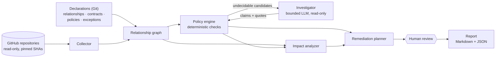

# repo-orchestrator

**Cross-repository coherence for independent GitHub repositories: model how they relate, detect where one repository's claims about another have become false, and explain the impact with evidence a human can check.**

> **Status: M1 implemented, M2–M5 design only.** [M1](docs/m1/README.md) is a working, read-only, deterministic scan of six public repositories: declared relationships, six policies (P1–P6), pinned evidence, Markdown and JSON reports, a local SQLite run store, no LLM. Everything else below (PR impact, bounded investigation, remediation plans, optimization opportunities) is **intended**, not implemented. The throwaway [S0 spike](prototypes/langgraph-spike/README.md) validated LangGraph on synthetic data and stays isolated from M1 (outcome: all six experiments passed, with constraints; the framework decision is the owner's: [results](prototypes/langgraph-spike/docs/results.md), [ADR-0005](docs/adr/0005-langgraph-for-investigation-workflows-only.md), still Proposed). All ADRs, including [ADR-0011](docs/adr/0011-m1-outcome-contracts-and-reproducible-reports.md) written for M1, are Proposed.

## The problem

Repositories that are developed independently still make claims about each other. A consumer pins a producer's schema version. A deployment repository serves the model tags an application hard-codes. A profile states how many ADRs another repository holds. A toolbox decides how every consumer must declare it. Each repository's CI and reviewers check the repository they run in; **nothing checks the claims between them**.

This is not hypothetical. Reading six public `koydas` repositories at fixed commits ([ecosystem baseline](docs/research/ecosystem-baseline.md)) found, among others:

- the profile README describing `agent-patterns` as having **17** patterns when it has **20**, despite the profile's own rule that descriptions must match the described repositories;
- the profile stating **59** ADRs for `autonomous-dev-loop`, which matches that repository's own README, while its ADR directory holds **65**: the drift is upstream, and a naive check would blame the wrong repository;
- a data contract (`findings.json`, `schema_version` 1) produced in one repository and consumed in another, kept in sync only by two constants that no shared check compares;
- a MetalLB address pool defined in one repository, with addresses claimed in two.

## Quick start (M1)

```bash
python -m venv .venv && . .venv/bin/activate && pip install -e '.[dev]'
repo-orchestrator scan                      # reads the six repositories at their default-branch HEAD (read-only, ~50 API requests)
repo-orchestrator scan --revisions baseline --offline --cache-dir tests/fixtures/baseline --as-of 2026-11-02   # the pinned baseline, no network
pytest                                      # unit tests + the offline evaluation against the pinned baseline
```

Exit codes: 0 no finding · 1 findings · 2 incomplete evaluation · 3 configuration/runtime error ([usage](docs/m1/usage.md)). On the pinned baseline the scan reports exactly the two documented inconsistencies (D1, D2, with D2 attributed to `autonomous-dev-loop`'s own README), two policy questions (N2, H1) and no false finding on the negative controls ([evaluation](docs/m1/evaluation.md)).

## What this project intends to do

The table states the **intent**; the *M1* column says what exists today.

| Capability | Intent | M1 |
|---|---|---|
| Relationship model | Typed edges between repositories (runtime contract, deployment, shared resource, tooling adoption, documentary, conceptual), declared by humans, with optional proposals from observers | **Implemented** for declared edges (R1–R11); observers and proposals: no |
| Coherence policies | A divergence is a finding only if a policy with a named authority says it matters; intentional divergence is recorded as an expiring exception | **Implemented**: P1–P6, precedence, exceptions, policy conflicts, policy questions; P7: no |
| Deterministic checks first | Versions, tags, addresses, counts and references are compared in code; an LLM investigates only what code cannot decide | **Implemented** (no LLM exists in M1) |
| Evidence | Every finding cites both repositories at pinned commits, with quotes verified in code; authentic evidence and a validated conclusion are separate statuses, so a verified quote never confirms a claim on its own | **Implemented** for deterministic checks (`verified`, `validated_by_check`) |
| PR impact | For a pull request, which other repositories it can break, falsify or outdate, and whether it introduces or resolves a finding | Not implemented (M2). M1 scans snapshots; the evaluation replays U1–U5 as in-memory mutations |
| Remediation plans | Ordered steps per repository with a prevention step; ADR conflicts reported as checked, candidate or not examined, and an unresolved conflict blocks approval; approved by a human, never merged by the system | Not implemented (M4). Findings carry fix sites and an investigation list |
| Optimization opportunities | Improvements that are not violations (propagate a proven guardrail, consolidate a genuinely shared contract, remove duplicated maintenance), each with pinned benefit evidence, cost, risk and the coupling it creates, decided by a human; never "make it uniform" | Not implemented (M5) |

**Not a code reviewer.** A reviewer reads one diff in one repository. This system reads the relationships between repositories and asks whether a claim on one side is still true on the other. It does not lint, test, or review code quality, and it does not enforce identical conventions where nothing depends on them.

**Coherence is not uniformity.** The baseline also records divergences that must **not** be reported: ADR naming formats that differ across repositories with no consumer, `new-adr` procedures duplicated in five repositories because an accepted ADR says skills belong to each repository, a settings file that differs from a toolbox ADR's literal text for a documented reason.

## Architecture (M1 implemented; the rest proposed)



The [M1 data flow as implemented](docs/m1/README.md#data-flow-as-implemented) covers the Collector, Relationship graph, Policy engine, report and run store; the Impact analyzer, Investigator and Remediation planner below are the M2–M4 design. One Python process, one SQLite file, no services. The Investigator is the only component that calls an LLM, and its output is verified in code before it can become a finding. LangGraph is the candidate engine for the investigation and approval workflow only; the isolated S0 spike [validated it](prototypes/langgraph-spike/docs/results.md) on synthetic data, with explicit constraints, without coupling the core to it. Details: [architecture](docs/architecture.md), [workflows](docs/workflows.md).

## Example scenarios

Grounded in the [baseline](docs/research/ecosystem-baseline.md). The first four are reproduced by the M1 evaluation as in-memory mutations of pinned snapshots (U1–U4) or as findings (D1, D2): M1 reports the *resulting state* of a snapshot. Reacting to a pull request is M2. The last two are M5 and not implemented.

| Scenario | Intended result |
|---|---|
| A PR in `autonomous-dev-loop` bumps `FINDINGS_SCHEMA_VERSION` to 2 | `ai-dev-tools` `scripts/loop-insights.mjs` listed as a consumer that will reject the export (impact: breaks); plan: consumer accepts both versions first, then the producer |
| A PR in `ollama-chat` changes `VISION_MODEL` | `gitops-homelab` does not pull the new tag (breaks); the manifest comment naming the consumer becomes false |
| A PR in `gitops-homelab` claims `192.168.1.244` | Collision with `ollama-chat` `k8s/service.yaml` (shared resource) |
| Baseline scan of the profile | Pattern count drift reported against the profile; ADR count drift attributed to `autonomous-dev-loop`'s README first |
| `status.json` is kept "same shape" by convention in two repositories | Opportunity (M5): a shared schema artifact, with the runtime-only detection risk as benefit evidence and the new cross-repository artifact as cost |
| A consolidation of the five `new-adr` skills is considered | Discarded at opportunity assessment: it contradicts `ai-dev-tools` ADR-018, which keeps skills per repository |

## Principles

- Deterministic checks before LLM reasoning; the LLM never decides a verdict.
- Every finding has evidence on both sides, pinned to commits, and a categorical verification status.
- Uncertainty is explicit: evidence `verified`, `supported`, `unverified`, `refuted`; validation of the conclusion as a separate status; intent `accidental`, `intentional`, `undetermined`.
- Relationships and policies are declared and reviewed in Git; inferred ones are proposals.
- Read-only first; every write, when it exists, is approved per item by a human. No merges.
- Stateful, resumable investigations, with budgets as code constants.
- Minimal operations: one process, one file, no infrastructure.

## Milestones

| Milestone | Scope | Status |
|---|---|---|
| M0 Design | Documentation and ADRs | **In review** |
| S0 LangGraph validation spike | Isolated, throwaway: checkpoints, interrupts, fan-out, budget guard; before or alongside M1 | **Executed, in review**: experiments A–F pass (81 tests); recommends adopting LangGraph for M3 with constraints; ADR-0005 still Proposed ([results](prototypes/langgraph-spike/docs/results.md)) |
| M1 Deterministic baseline | Six repositories, six deterministic policies, local report, evaluation set | **Implemented, in review**: [docs](docs/m1/README.md), offline evaluation green, live read-only scan recorded ([evaluation](docs/m1/evaluation.md)) |
| M2 PR impact | Cross-repository impact of a PR, base/head comparison | Not started |
| M3 Bounded investigation | LangGraph-backed Investigator, quote verification, claim validation, human interrupts | Not started |
| M4 Remediation plans | Ordered plans, three-tier ADR compatibility, regression detection | Not started |
| M5 Optimization opportunities | Opportunity lifecycle, benefit/cost/risk assessment, human decision | Not started |

Deferred, each behind its own ADR: scheduled scans, PR comments, coordinated issues and PRs, automatic relationship discovery, longitudinal metrics. See [MVP](docs/mvp.md).

## Documentation

| Document | Contents |
|---|---|
| [Vision](docs/vision.md) | Goals, non-goals, users, success criteria, differentiation |
| [Architecture](docs/architecture.md) | Components, boundaries, data flow, orchestration, security, complexity budget |
| [Domain model](docs/domain-model.md) | Entities, relationship types, invariants, finding lifecycle, uncertainty model |
| [Coherence model](docs/coherence-model.md) | Meaningful inconsistency, scopes, precedence, exceptions, prioritization, evidence, MVP policies |
| [Workflows](docs/workflows.md) | Baseline scan, PR analysis, LangGraph workflow, failure handling, human intervention |
| [MVP](docs/mvp.md) | Scope, milestones, deferred capabilities, evaluation design |
| [S0 spike](prototypes/langgraph-spike/README.md) | LangGraph validation on synthetic data: architecture, experiments A–F, results, recommendation |
| [Ecosystem baseline](docs/research/ecosystem-baseline.md) | Verified relationships and inconsistencies, hypotheses, open questions, with revisions |
| [M1](docs/m1/README.md) | What is implemented: usage, declarations, policies, report format, evaluation, limitations |
| [ADRs](docs/adr/README.md) | Eleven Proposed decisions |
| [Claude Code](docs/claude-code.md) | `ai-dev-tools` toolbox, repository rules (`CLAUDE.md`) and skills |

## Relation to the rest of the ecosystem

- [`autonomous-dev-loop`](https://github.com/koydas/autonomous-dev-loop) reviews PRs inside one repository with tool evidence, impact analysis and document evidence; its ADR-0039 prototypes LangGraph for a single-repository write loop. This project addresses what happens **between** repositories, read-only, and reuses its lessons (code-checked quotes, verification statuses, caps as constants).
- [`ai-dev-tools`](https://github.com/koydas/ai-dev-tools) provides the human-gated interactive toolbox; its "human as gate" model applies here unchanged.

## License

[MIT](LICENSE)
