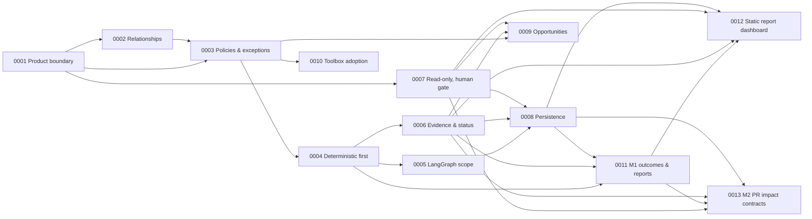

# ADR Index

Architecture Decision Records for `repo-orchestrator`. All records are **Proposed**: none has been approved. A record becomes Accepted only by an explicit decision of the repository owner, recorded in the file.

Format: `NNNN-kebab-title.md`, sections Context / Decision / Rationale / Alternatives considered / Consequences / Open questions. Numbers are sequential and never reused; an accepted record is superseded, not edited.

## Records

| ADR | Title | Status |
|---|---|---|
| [ADR-0001](./0001-cross-repository-coherence-as-product-boundary.md) | Cross-repository coherence is the product boundary | Proposed |
| [ADR-0002](./0002-explicit-typed-relationship-model.md) | Relationships are explicit, typed and declared before they are inferred | Proposed |
| [ADR-0003](./0003-policy-driven-coherence-with-scoped-exceptions.md) | Coherence is policy-driven, scoped, and admits recorded exceptions | Proposed |
| [ADR-0004](./0004-deterministic-checks-before-agentic-reasoning.md) | Deterministic checks first; bounded agentic reasoning only where they cannot decide | Proposed |
| [ADR-0005](./0005-langgraph-for-investigation-workflows-only.md) | LangGraph orchestrates the investigation and approval workflow; the deterministic core stays plain Python | Proposed |
| [ADR-0006](./0006-evidence-provenance-uncertainty-and-reproducibility.md) | Evidence is pinned to revisions, findings carry an explicit verification status, and every run is reproducible | Proposed |
| [ADR-0007](./0007-read-only-operation-and-human-gated-remediation.md) | Read-only operation first; remediation is planned by the system and approved by a human | Proposed |
| [ADR-0008](./0008-git-declarations-and-local-sqlite-state.md) | Declarations live in Git; runtime state lives in one local SQLite file | Proposed |
| [ADR-0009](./0009-optimization-opportunities-as-first-class-output.md) | Optimization opportunities are a first-class output with their own lifecycle | Proposed |
| [ADR-0010](./0010-claude-code-toolbox-adoption.md) | Adopt the ai-dev-tools toolbox and the ecosystem's Claude Code conventions | Proposed |
| [ADR-0011](./0011-m1-outcome-contracts-and-reproducible-reports.md) | M1 outcome contracts, reproducible reports and run identity | Proposed |
| [ADR-0012](./0012-static-report-dashboard.md) | A static, read-only report dashboard generated from `report.json` | Proposed |
| [ADR-0013](./0013-m2-pr-impact-contracts.md) | M2 pull-request analysis contracts: change set, impact, delta, gate and persistence | Proposed |

## Dependencies between records

