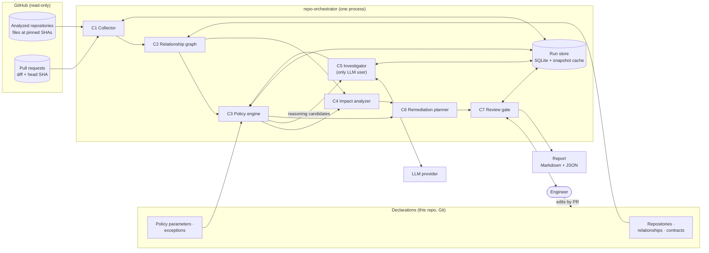

# Architecture

> **Status: proposed design. Nothing described here is implemented.**

Conceptual architecture of `repo-orchestrator`. The components below are **logical responsibilities inside one Python package and one process**, not services. Decisions: [ADR index](adr/README.md).

## System context

No arrow points back into GitHub: the MVP has no write path ([ADR-0007](adr/0007-read-only-operation-and-human-gated-remediation.md)).

## Components

### C1 Collector

- **Does:** resolve each declared repository to a SHA (default branch HEAD, or the PR's head and base for the changed repository), fetch the artifacts the declarations and policies need, store them content-addressed, emit Artifacts with kinds.
- **Inputs:** repository list, PR reference (optional), artifact selectors from relationships and policies.
- **Outputs:** pinned snapshots, Artifacts.
- **Boundary:** the only component that talks to GitHub. Read-only token. Retries transient errors with bounded backoff; a repository that cannot be fetched marks every policy touching it `cannot_evaluate` for the run.
- **Deterministic.**

### C2 Relationship graph

- **Does:** load declared relationships and contracts, attach anchors to the snapshot's Artifacts, run deterministic **observers** that propose `observed` relationships (for example an Argo CD `repoURL` pointing at another analyzed repository).
- **Outputs:** an in-memory typed graph; proposed relationships for the report.
- **Boundary:** observed and inferred relationships are reported, never traversed, until a human declares them ([ADR-0002](adr/0002-explicit-typed-relationship-model.md)).
- **Deterministic.**

### C3 Policy engine

- **Does:** resolve applicable policies per relationship with the precedence rules ([coherence model](coherence-model.md#precedence)), run deterministic checks, run reasoning pre-filters, apply exceptions, compute fingerprints and lifecycle transitions, verify Investigator quotes.
- **Outputs:** findings (`candidate` → `confirmed` / `needs_validation` / `insufficient_evidence` / `dismissed` / `excepted`), policy conflicts, `cannot_evaluate` records.
- **Boundary:** the only component that sets a finding's verification status. Policies are Python functions with declared metadata; no policy DSL.
- **Deterministic.**

### C4 Impact analyzer

- **Does:** for a change set, map changed files and changed extracted values (versions, tags, addresses, counts) to the Artifacts anchoring relationships; traverse one hop by default; classify each affected repository as `breaks` / `falsifies` / `outdates` from the relationship type; evaluate the affected policies on the PR head against the other repositories' current snapshots.
- **Outputs:** Impact Assessment.
- **Boundary:** one hop unless a contract declares transitivity; no transitive closure by default (noise).
- **Deterministic.**

### C5 Investigator

- **Does:** for one reasoning candidate, read more of the pinned snapshots through read-only tools and return a structured claim with verbatim quotes, a proposed verification outcome and a proposed intent with justification.
- **Boundary:** the **only** component that calls an LLM. No network beyond the LLM call, no shell, no write tool. Budgets are code constants ([ADR-0004](adr/0004-deterministic-checks-before-agentic-reasoning.md)). Its output is a proposal; C3 decides.
- **Agentic, bounded.**

### C6 Remediation planner

- **Does:** for confirmed findings, propose ordered steps per repository (fix site, order constraints such as "consumer first" for a version bump), check them against the accepted ADRs of each touched repository, and add a prevention step.
- **Boundary:** produces text in the report. Ordering is computed from relationship semantics. ADR compatibility is reported in three tiers ([coherence model](coherence-model.md#adr-compatibility)): formalized constraints checked in code; candidate semantic conflicts proposed by C5 with verified quotes; ADRs not examined. "No conflict detected" is never reported as "compatible", and an unresolved candidate conflict blocks approval of the plan (fail-closed). MVP milestone M4; from M5 it assesses Optimization Opportunities under the same rules ([ADR-0009](adr/0009-optimization-opportunities-as-first-class-output.md)).

### C7 Review gate

- **Does:** assemble the report, pause for human triage where the workflow requires it, record human decisions (acknowledge, dismiss, request exception), write the report files.
- **Boundary:** in the MVP, writes only to the local filesystem and the run store.

### Run store

SQLite file plus snapshot cache ([ADR-0008](adr/0008-git-declarations-and-local-sqlite-state.md)): findings by fingerprint with history, Run Records, checkpoints.

## Data flow

| Step | From → To | Payload | Deterministic |
|---|---|---|---|
| 1 | Declarations → C2, C3 | Relationships, contracts, policy parameters, exceptions (revision recorded) | Yes |
| 2 | GitHub → C1 | Files at pinned SHAs; PR diff | Yes |
| 3 | C1 → C2 | Artifacts | Yes |
| 4 | C2 → C3, C4 | Typed graph | Yes |
| 5 | C3 → C5 | Reasoning candidates with pre-collected evidence | Yes |
| 6 | C5 → C3 | Claims with quotes | **No** (recorded for replay) |
| 7 | C3, C4 → C6 | Confirmed findings, Impact Assessment | Yes |
| 8 | C6 → C7 → human | Report, plans | Assembly yes; wording may be LLM-drafted |

## Orchestration strategy

- **S0** (first implementation activity, before or alongside M1): an isolated, throwaway LangGraph design-validation spike outside the core package ([ADR-0005](adr/0005-langgraph-for-investigation-workflows-only.md) §5), executed in [`prototypes/langgraph-spike`](../prototypes/langgraph-spike/README.md) ([architecture](../prototypes/langgraph-spike/docs/architecture.md), [results](../prototypes/langgraph-spike/docs/results.md)). The core never imports it.
- **M1–M2:** a plain function pipeline: `collect → build_graph → evaluate → (impact) → report`. One command, no framework.
- **M3:** the investigation and approval part becomes a LangGraph graph whose nodes call the same functions, on the design S0 validated (or the hand-written fallback if S0 failed). The graph is specified in [workflows.md](workflows.md#langgraph-workflow).

Why not a simpler pipeline throughout: once investigations exist, the run must survive LLM failures per candidate, budget exhaustion, and human pauses of arbitrary length. Written by hand, that is a resumable state machine with a persisted status per candidate; LangGraph provides it. Before investigations exist, it provides nothing the pipeline needs, which is why S0 tests it in isolation instead of in the core.

## Security boundaries

| Boundary | Rule |
|---|---|
| GitHub credentials | Fine-grained, read-only (`contents: read`, `pull_requests: read`) on the analyzed repositories. No write scope exists in the MVP. |
| Repository content | Untrusted data. Quotes reach prompts fenced and labelled as data; an instruction in repository text is reported as an observation, never followed. |
| LLM | Sees only pinned snapshot content selected by C3/C5, never credentials or the run store. Has no tool that writes, executes or reaches the network. |
| Execution | No code from analyzed repositories is executed, imported or built. Extractors parse text (YAML, JSON, Markdown, source as text). |
| Outputs | Local files. Reports quote repository content; for private repositories they inherit its confidentiality (open question in [ADR-0006](adr/0006-evidence-provenance-uncertainty-and-reproducibility.md)). |
| Declarations | Changed only through pull requests in this repository; their revision is part of every Run Record. |

## Complexity budget

What the design deliberately does **not** include, and the trigger that would justify revisiting:

| Not included | Revisit when |
|---|---|
| Separate services, queues, API server | More than one concurrent user or a hosted deployment is required |
| Graph database | Relationship count exceeds what an in-memory rebuild handles per run (thousands of edges) |
| Vector store / embeddings | Recall measurements show pre-filters miss semantic inconsistencies that retrieval would find |
| Multiple agents (critic, planner, judge) | Measured precision of `supported` findings is insufficient and a second independent check is cheaper than a human |
| Policy DSL | Policies must be authored by people who do not write Python |
| Automatic relationship discovery driving findings | Declared relationships no longer cover the analyzed set; discovery output has a measured precision |
| GitHub writes | Precision targets of the MVP met over a sustained period; a level ≥ 2 ADR accepted |
