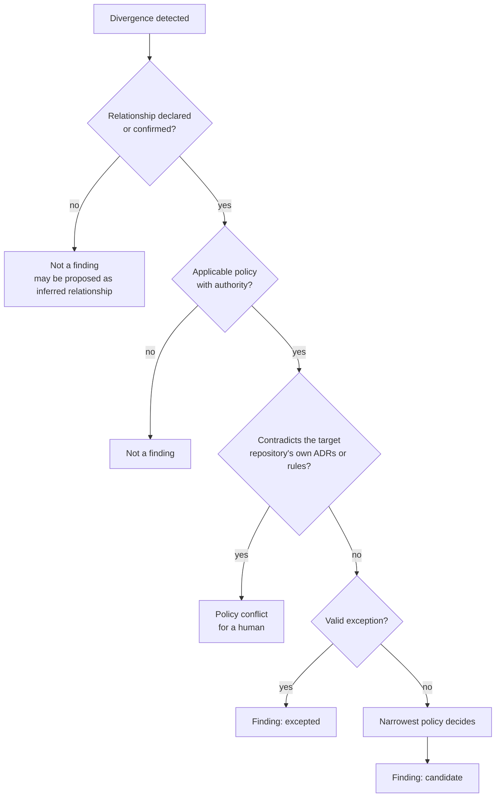

# Coherence model

What this system treats as a meaningful inconsistency, how policies are scoped and resolved, how exceptions work, how findings are prioritized, and what evidence each finding needs. Decisions: [ADR-0003](adr/0003-policy-driven-coherence-with-scoped-exceptions.md), [ADR-0004](adr/0004-deterministic-checks-before-agentic-reasoning.md), [ADR-0006](adr/0006-evidence-provenance-uncertainty-and-reproducibility.md).

## Meaningful inconsistency

A divergence is a finding only when **all three** hold:

1. **A relationship exists** between the repositories involved, declared or confirmed ([ADR-0002](adr/0002-explicit-typed-relationship-model.md)).
2. **A policy applies**, with an authority a human wrote, and no valid exception covers it.
3. **Something is false or at risk**: a consumer can break, a published claim is false, or a shared resource can collide, at the analyzed revisions or on merge of the analyzed change.

| Kind | Example from the [baseline](research/ecosystem-baseline.md) | Meaningful? |
|---|---|---|
| Contract drift | Producer bumps `findings.json` `schema_version`; consumer still supports 1 (U1) | Yes: consumer breaks |
| Descriptive drift | Profile says 17 patterns, `agent-patterns` has 20 (D1) | Yes: the profile's own rule (R1) makes it a defect |
| Upstream descriptive drift | Profile matches `autonomous-dev-loop` README (59), both disagree with its ADR directory (65) (D2) | Yes, **attributed upstream** |
| Shared-resource conflict | Two repositories claim the same MetalLB address (U3) | Yes: collision |
| Convention divergence with no consumer | ADR file naming `NNNN-` vs `ADR-NNN-` (N1) | No |
| Documented divergence | `autonomous-dev-loop` `settings.json` carries hooks beyond ADR-018's two keys (N2) | No finding; a **policy clarification** question |
| Decided duplication | `new-adr` skills in five repositories (N3) | No finding; an opportunity would contradict `ai-dev-tools` ADR-018 |
| Historical ADR vs current state | `gitops-homelab` ADR-0015 vs `ollama-chat` ADR-0007 (N4) | No: ADRs are point-in-time; living docs agree |

## Policy scopes

| Scope | Applies to | Example |
|---|---|---|
| `global` | Every declared relationship | "Cross-repository references resolve" (P5) |
| `relationship_type` | Every relationship of a type | "Every `runtime_contract` with a version field agrees on it" (P2) |
| `relationship` | One edge | "`ollama-chat` model tags are served by `gitops-homelab`" (P3) |
| `repository` | One repository's outgoing claims | "Profile counts match the described repositories" (P1) |

A policy has: id, version, scope, check kind, authority (an artifact in some repository), impact class (`breaks` / `falsifies` / `outdates`), parameters (declared), and the check (code).

## Precedence

Applied in order ([ADR-0003](adr/0003-policy-driven-coherence-with-scoped-exceptions.md) §5):

1. **Repository authority.** A repository's own accepted ADR or instruction file governs its internal conventions. A wider policy that contradicts it raises a **policy conflict** for a human, never a finding against the repository.
2. **Valid exception.** Suppresses the matching finding (state `excepted`, still listed in the report).
3. **Narrowest scope wins** among applicable policies on the same subject: `repository` > `relationship` > `relationship_type` > `global`.
4. **Same-scope conflict** is a configuration error at load time; the run stops before collecting anything.

## Intentional exceptions

| Field | Rule |
|---|---|
| Policy and scope | Which policy, which repositories or artifacts. No wildcard over all repositories. |
| Justification | One paragraph, in the record. |
| Authority | Link to the artifact that makes the divergence intentional (an ADR, a `CLAUDE.md` line). |
| Owner | Who reviews it. |
| Review by | A date. After it, the exception stops applying and the finding returns to `confirmed`. |

**M1:** exceptions are declared in `declarations/exceptions.yaml` with every field required and no wildcard; `review_by` is judged at the run's `--as-of` date (an input of the run, so results stay reproducible), an exception whose authority artifact or quote does not resolve at the pinned revision is not applied, and an applied exception turns a `confirmed` finding into an `excepted` one that stays listed. Exceptions never change `cannot_evaluate`. No exception is declared at the baseline.

An exception is the only way a finding becomes `intentional`. The Investigator can **propose** one, with quotes; a human records it.

## Prioritization

Severity derives from the impact class of the policy and the relationship type, not from an LLM. In a PR analysis (M2) the same severity is shown on each finding, and the *affected repository* is the one the change can break, falsify or outdate by the relationship's type ([impact model](m2/impact-model.md#4-direction-and-impact-class)); a pre-existing finding keeps its severity but never fails the gate.

| Severity | When | Examples |
|---|---|---|
| **High** | `breaks`: `runtime_contract`, `build_dependency`, `deployment`, `shared_resource` collision | P2, P3, P4 failures |
| **Medium** | `falsifies`: a published or instruction-level claim about another repository is false; a `tooling_adoption` policy fails | P1, P5, P6 failures |
| **Low** | `outdates`: a `conceptual` relationship lags its source | `agent-patterns` "Running in" claims after a renamed feature |
| *(not a severity)* | Opportunities, policy conflicts, inferred relationships | Listed in separate report sections |

Within a severity, order by: validation (`validated_by_check` before `validated_by_human`; `needs_validation` findings are listed in their own section, never ranked as confirmed), then blast radius (number of affected repositories), then age (`first_seen`).

## Evidence requirements

| Check kind | A finding needs | Otherwise |
|---|---|---|
| `deterministic` | Evidence on **both sides** of the relationship, from a named extractor version, at pinned SHAs; the comparator and its result | `cannot_evaluate` (with reason) |
| `reasoning_assisted` | Everything above, plus every Investigator quote verified in code at its cited location (evidence `supported`), plus the quoted policy authority; **then** validation by the policy's entailment check or a human before `confirmed` | `unverified` → `insufficient_evidence`; a failing quote → `refuted`; quotes verified but not validated → `needs_validation` |
| Any | The policy authority artifact resolved at its pinned revision | The policy is not evaluated in this run |

A finding that cites only one repository is out of scope ([ADR-0001](adr/0001-cross-repository-coherence-as-product-boundary.md) §4), with one allowance: an upstream root cause (D2) is reported **inside** the cross-repository finding that exposed it, as its fix site.

## ADR compatibility

Whether a remediation plan or an opportunity is compatible with the accepted ADRs of the repositories it touches is **not generally computable**: most ADR constraints are prose. It is reported in three tiers, never as a single verdict:

| Tier | Source | What it can say |
|---|---|---|
| 1. Formalized constraints | ADR decisions encoded as policies or declared constraints (for example P6 encodes `ai-dev-tools` ADR-018's two-key rule) | Checked in code: pass or conflict |
| 2. Candidate semantic conflicts | The bounded Investigator reads the prose of accepted ADRs in the touched repositories ([ADR-0004](adr/0004-deterministic-checks-before-agentic-reasoning.md) §7) | A candidate conflict with verified quotes; never "compatible" |
| 3. Not examined | ADRs outside budget, unreadable, or not in a touched repository | Listed by name |

Rules:

- The report states "no conflict detected among N formalized constraints and M ADRs reviewed; K not examined", never "compatible".
- **Fail-closed.** A plan or opportunity with an unresolved tier-1 conflict or tier-2 candidate cannot be approved. A human resolves it by dismissing the candidate with a reason, or by a superseding decision in the owning repository.
- Tier-3 ADRs do not block, but approval requires the human to see their list.

## Optimization opportunities

Improvements that are not violations ([ADR-0009](adr/0009-optimization-opportunities-as-first-class-output.md)). Kinds: `guardrail_propagation`, `contract_consolidation`, `maintenance_deduplication`.

**Anti-uniformity test**: an opportunity is proposed only if all hold:

1. The repositories are related by a declared relationship, or share a concern evidenced in both.
2. Pinned **benefit evidence** exists: an incident, a recurring finding, an ADR in the source repository recording why a guardrail exists, repeated maintenance. "The other repositories do it this way" is never benefit evidence.
3. Cost and risk are stated, including the **coupling** the change creates (a consolidated contract is a new `runtime_contract` with an owner).
4. ADR compatibility passes the fail-closed rule above.

| Candidate (illustrative, from the [baseline](research/ecosystem-baseline.md)) | Outcome under the test |
|---|---|
| A shared schema artifact for `status.json`, kept "same shape" by convention in two repositories (R3) | Assessable: benefit evidence is the H4 risk (a shape change caught only at runtime); cost is a new cross-repository artifact and its owner (H5) |
| Consolidating the duplicated plugin declaration or the per-repository `new-adr` skills (N3) | Discarded: `ai-dev-tools` ADR-018 accepts that duplication and keeps skills per repository |
| Carrying a "never shrink a test file" guardrail to a related repository that lacks it | Assessable only with the incident behind the guardrail (`autonomous-dev-loop` ADR-0009) as benefit evidence; `ollama-chat`'s `test-and-lint` skill already has a counterpart |

Assessment is categorical (benefit, cost, risk: high / medium / low, each with its evidence). A declined opportunity is not proposed again unless its evidence changes.

## Counting claims

Counts in descriptions (ADRs, patterns, incidents, tests) are the most common verified drift (D1, D2). They are only checkable with a declared **counting rule** per claim:

| Claim | Rule (proposed default) | Tolerance |
|---|---|---|
| "N ADRs" | Numbered ADR files in the repository's ADR directory, all statuses, both naming formats | Exact |
| "N patterns" | Directories under `patterns/` | Exact |
| "N incidents" | `###` headings under the declared runbook section | Exact |
| "N+ tests" | Not checked deterministically in the MVP (no reliable static count); reported as `cannot_evaluate` | Lower bound |

The rule is a parameter of the policy, reviewed like any declaration. **M1** implements `numbered_adr_files`, `pattern_dirs`, `h3_under_h2` and `tests_lower_bound` (reported as not checkable by design). `numbered_adr_files` is marked *provisional* on Q2: a finding that uses it names Q2, and a claim that equals the count under the declared alternative (`adr_index_entries`) is a policy clarification instead of a finding. On the baseline D2 stays a finding, because 59 matches neither count (65 files, 65 index entries). A different rule (for example Accepted ADRs only) changes D2's outcome; that is why baseline Q2 is an open question, not a design detail.

## MVP policy catalog

Seven policies, six deterministic. Detailed scope and milestones in [mvp.md](mvp.md).

| ID | Policy | Scope | Check | Relationship(s) | Authority |
|---|---|---|---|---|---|
| P1 | Profile counts match the described repositories; when the described repository's README carries the same count, it is checked too and named as the fix site if stale | repository (`koydas`) | deterministic | R1 | `koydas CLAUDE.md:3` |
| P2 | Published JSON contracts agree on `schema_version` and key set | relationship_type (`runtime_contract`) | deterministic | R2, R3 | `ai-dev-tools` ADR-017; `autonomous-dev-loop` ADR-0047 |
| P3 | Model tags hard-coded by `ollama-chat` are pulled by `gitops-homelab` | relationship | deterministic | R7 | `ollama-chat` ADR-0009 |
| P4 | MetalLB addresses claimed in any analyzed repository are unique and inside the declared pool | relationship_type (`shared_resource`) | deterministic | R8 | `gitops-homelab` ADR-0008 |
| P5 | References from one analyzed repository to a file of another resolve at the target snapshot | global | deterministic | R9 and every documentary edge | This repository, [ADR-0001](adr/0001-cross-repository-coherence-as-product-boundary.md) |
| P6 | Repositories in the plugin-adoption scope declare the two plugin keys identically, and appear in the adopter table with their skills | relationship_type (`tooling_adoption`) | deterministic, with exceptions | R5 | `ai-dev-tools` ADR-018 |
| P7 | Qualitative descriptive claims in the profile (for example "12 extracted from the two repos above") agree with the described repository's own statements | repository (`koydas`) | reasoning-assisted | R1, R4 | `koydas CLAUDE.md:3` |

P6 is deliberately the policy with open questions (baseline Q1, Q3): it exercises `undetermined` intent, exceptions and policy conflicts on real data.

**M1 status.** P1–P6 are implemented at version 1.0.0 ([policies](m1/policies.md)); P7 is not (M3). Ambiguous applicability is a distinct outcome, `policy_clarification` (N2 and H1 on the baseline), not a weak finding. The policy-conflict path (precedence rule 1) and expiring exceptions are implemented and exercised by the offline suite on synthetic declarations, because the pinned baseline needs neither.

**M2 status.** The policies are unchanged. A pull request analysis evaluates the policies of the touched relationships on the PR base and head and labels each finding `introduced`, `pre-existing`, `resolved` or `undetermined` ([ADR-0012](adr/0012-m2-pr-impact-contracts.md)); `cannot_evaluate` on either side is never `introduced` or `resolved`.
