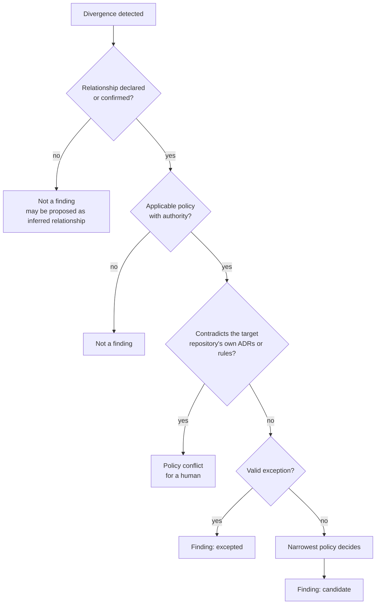

# Coherence model

What this system treats as a meaningful inconsistency, how policies are scoped and resolved, how exceptions work, how findings are prioritized, and what evidence each finding needs. Decisions: [ADR-0003](adr/0003-policy-driven-coherence-with-scoped-exceptions.md), [ADR-0004](adr/0004-deterministic-checks-before-agentic-reasoning.md), [ADR-0006](adr/0006-evidence-provenance-uncertainty-and-reproducibility.md).

## Meaningful inconsistency

A divergence is a finding only when **all three** hold:

1. **A relationship exists** between the repositories involved, declared or confirmed ([ADR-0002](adr/0002-explicit-typed-relationship-model.md)).
2. **A policy applies**, with an authority a human wrote, and no valid exception covers it.
3. **Something is false or at risk**: a consumer can break, a published claim is false, or a shared resource can collide, at the analyzed revisions or on merge of the analyzed change.

| Kind | Example from the [baseline](research/ecosystem-baseline.md) | Meaningful? |
|---|---|---|
| Contract drift | Producer bumps `findings.json` `schema_version`; consumer still supports 1 (U1) | Yes: consumer breaks |
| Descriptive drift | Profile says 17 patterns, `agent-patterns` has 20 (D1) | Yes: the profile's own rule (R1) makes it a defect |
| Upstream descriptive drift | Profile matches `autonomous-dev-loop` README (59), both disagree with its ADR directory (65) (D2) | Yes, **attributed upstream** |
| Shared-resource conflict | Two repositories claim the same MetalLB address (U3) | Yes: collision |
| Convention divergence with no consumer | ADR file naming `NNNN-` vs `ADR-NNN-` (N1) | No |
| Documented divergence | `autonomous-dev-loop` `settings.json` carries hooks beyond ADR-018's two keys (N2) | No finding; a **policy clarification** question |
| Decided duplication | `new-adr` skills in five repositories (N3) | No finding; an opportunity would contradict `ai-dev-tools` ADR-018 |
| Historical ADR vs current state | `gitops-homelab` ADR-0015 vs `ollama-chat` ADR-0007 (N4) | No: ADRs are point-in-time; living docs agree |

## Policy scopes

| Scope | Applies to | Example |
|---|---|---|
| `global` | Every declared relationship | "Cross-repository references resolve" (P5) |
| `relationship_type` | Every relationship of a type | "Every `runtime_contract` with a version field agrees on it" (P2) |
| `relationship` | One edge | "`ollama-chat` model tags are served by `gitops-homelab`" (P3) |
| `repository` | One repository's outgoing claims | "Profile counts match the described repositories" (P1) |

A policy has: id, version, scope, check kind, authority (an artifact in some repository), impact class (`breaks` / `falsifies` / `outdates`), parameters (declared), and the check (code).

## Precedence

Applied in order ([ADR-0003](adr/0003-policy-driven-coherence-with-scoped-exceptions.md) §5):

1. **Repository authority.** A repository's own accepted ADR or instruction file governs its internal conventions. A wider policy that contradicts it raises a **policy conflict** for a human, never a finding against the repository.
2. **Valid exception.** Suppresses the matching finding (state `excepted`, still listed in the report).
3. **Narrowest scope wins** among applicable policies on the same subject: `repository` > `relationship` > `relationship_type` > `global`.
4. **Same-scope conflict** is a configuration error at load time; the run stops before collecting anything.

## Intentional exceptions

| Field | Rule |
|---|---|
| Policy and scope | Which policy, which repositories or artifacts. No wildcard over all repositories. |
| Justification | One paragraph, in the record. |
| Authority | Link to the artifact that makes the divergence intentional (an ADR, a `CLAUDE.md` line). |
| Owner | Who reviews it. |
| Review by | A date. After it, the exception stops applying and the finding returns to `confirmed`. |

An exception is the only way a finding becomes `intentional`. The Investigator can **propose** one, with quotes; a human records it.

## Prioritization

Severity derives from the impact class of the policy and the relationship type, not from an LLM.

| Severity | When | Examples |
|---|---|---|
| **High** | `breaks`: `runtime_contract`, `build_dependency`, `deployment`, `shared_resource` collision | P2, P3, P4 failures |
| **Medium** | `falsifies`: a published or instruction-level claim about another repository is false; a `tooling_adoption` policy fails | P1, P5, P6 failures |
| **Low** | `outdates`: a `conceptual` relationship lags its source | `agent-patterns` "Running in" claims after a renamed feature |
| *(not a severity)* | Opportunities, policy conflicts, inferred relationships | Listed in separate report sections |

Within a severity, order by: verification (`verified` before `supported`), then blast radius (number of affected repositories), then age (`first_seen`).

## Evidence requirements

| Check kind | A finding needs | Otherwise |
|---|---|---|
| `deterministic` | Evidence on **both sides** of the relationship, from a named extractor version, at pinned SHAs; the comparator and its result | `cannot_evaluate` (with reason) |
| `reasoning_assisted` | Everything above, plus every Investigator quote verified in code at its cited location, plus the quoted policy authority | `unverified` → `insufficient_evidence`; a failing quote → `refuted` |
| Any | The policy authority artifact resolved at its pinned revision | The policy is not evaluated in this run |

A finding that cites only one repository is out of scope ([ADR-0001](adr/0001-cross-repository-coherence-as-product-boundary.md) §4), with one allowance: an upstream root cause (D2) is reported **inside** the cross-repository finding that exposed it, as its fix site.

## Counting claims

Counts in descriptions (ADRs, patterns, incidents, tests) are the most common verified drift (D1, D2). They are only checkable with a declared **counting rule** per claim:

| Claim | Rule (proposed default) | Tolerance |
|---|---|---|
| "N ADRs" | Numbered ADR files in the repository's ADR directory, all statuses, both naming formats | Exact |
| "N patterns" | Directories under `patterns/` | Exact |
| "N incidents" | `###` headings under the declared runbook section | Exact |
| "N+ tests" | Not checked deterministically in the MVP (no reliable static count); reported as `cannot_evaluate` | Lower bound |

The rule is a parameter of the policy, reviewed like any declaration. A different rule (for example Accepted ADRs only) changes D2's outcome; that is why baseline Q2 is an open question, not a design detail.

## MVP policy catalog

Seven policies, six deterministic. Detailed scope and milestones in [mvp.md](mvp.md).

| ID | Policy | Scope | Check | Relationship(s) | Authority |
|---|---|---|---|---|---|
| P1 | Profile counts match the described repositories; when the described repository's README carries the same count, it is checked too and named as the fix site if stale | repository (`koydas`) | deterministic | R1 | `koydas CLAUDE.md:3` |
| P2 | Published JSON contracts agree on `schema_version` and key set | relationship_type (`runtime_contract`) | deterministic | R2, R3 | `ai-dev-tools` ADR-017; `autonomous-dev-loop` ADR-0047 |
| P3 | Model tags hard-coded by `ollama-chat` are pulled by `gitops-homelab` | relationship | deterministic | R7 | `ollama-chat` ADR-0009 |
| P4 | MetalLB addresses claimed in any analyzed repository are unique and inside the declared pool | relationship_type (`shared_resource`) | deterministic | R8 | `gitops-homelab` ADR-0008 |
| P5 | References from one analyzed repository to a file of another resolve at the target snapshot | global | deterministic | R9 and every documentary edge | This repository, [ADR-0001](adr/0001-cross-repository-coherence-as-product-boundary.md) |
| P6 | Repositories in the plugin-adoption scope declare the two plugin keys identically, and appear in the adopter table with their skills | relationship_type (`tooling_adoption`) | deterministic, with exceptions | R5 | `ai-dev-tools` ADR-018 |
| P7 | Qualitative descriptive claims in the profile (for example "12 extracted from the two repos above") agree with the described repository's own statements | repository (`koydas`) | reasoning-assisted | R1, R4 | `koydas CLAUDE.md:3` |

P6 is deliberately the policy with open questions (baseline Q1, Q3): it exercises `undetermined` intent, exceptions and policy conflicts on real data.
