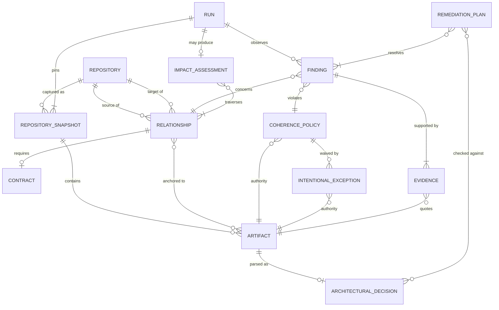
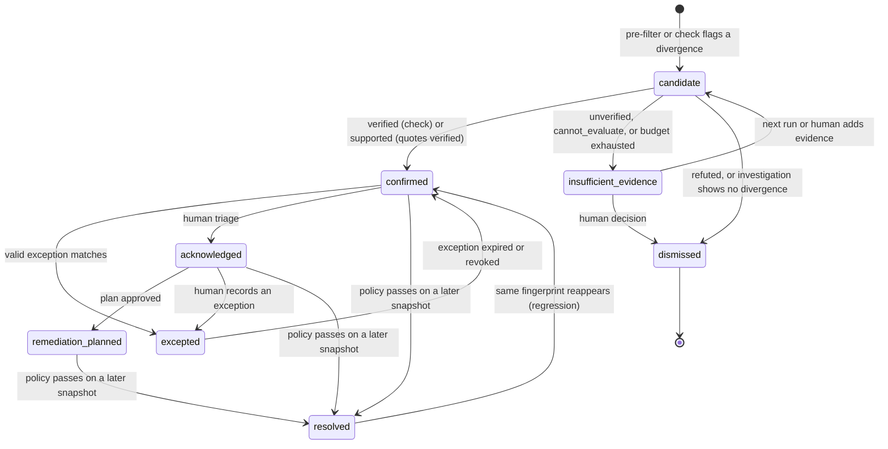

# Domain model

Conceptual model, not a schema. Field lists name what each concept must carry to answer the questions in [§ Questions the model answers](#questions-the-model-answers); storage follows [ADR-0008](adr/0008-git-declarations-and-local-sqlite-state.md).

## Concepts

| Concept | What it is | Origin |
|---|---|---|
| **Repository** | A GitHub repository in the analyzed set: `owner/name`, default branch, visibility. | Declared |
| **Repository Snapshot** | A repository at one commit SHA. All evidence of a run refers to snapshots pinned at run start. | Collected |
| **Artifact** | A file or a located part of a file in a snapshot, with a kind: `adr`, `readme`, `instruction` (`CLAUDE.md`, `AGENTS.md`), `skill`, `workflow`, `manifest` (k8s, Argo CD), `config`, `source`, `doc`. | Extracted |
| **Architectural Decision** | An `adr` artifact parsed into number, title, status, supersession links. Format-tolerant: `NNNN-*` and `ADR-NNN-*` both parse (baseline N1). | Extracted |
| **Relationship** | Typed, directed edge between two repositories, optionally anchored to artifacts on each side, with an origin (`declared`, `observed`, `inferred`) ([ADR-0002](adr/0002-explicit-typed-relationship-model.md)). | Declared / observed / inferred |
| **Contract** | The property a `runtime_contract`, `deployment` or `shared_resource` relationship requires to agree: producer locator, consumer locator, comparator (equal, member-of, unique-within-range, exists). | Declared |
| **Coherence Policy** | A rule that makes a divergence matter: id, version, scope, check kind (`deterministic` / `reasoning_assisted`), authority, impact class ([ADR-0003](adr/0003-policy-driven-coherence-with-scoped-exceptions.md)). | Declared (code + parameters) |
| **Intentional Exception** | A recorded, justified, expiring suppression of a policy for a scope. | Declared |
| **Finding** | A policy violation on a relationship, with evidence, verification status, intent, severity and lifecycle state. | Produced |
| **Evidence** | A quote pinned to `(repository, SHA, path, locator)` with its hash and producer ([ADR-0006](adr/0006-evidence-provenance-uncertainty-and-reproducibility.md)). | Produced |
| **Impact Assessment** | For a change set (a PR or a commit range), the relationships it touches and, per affected repository, what can happen: `breaks`, `falsifies`, `outdates`. | Produced |
| **Remediation Plan** | Ordered steps per repository to resolve one or more findings, with ADR compatibility and a prevention step. | Produced, approved by a human |
| **Opportunity** | A consolidation or propagation suggestion; never a finding. States the ADRs it is compatible with or contradicts. | Produced |
| **Run** | One execution: pinned snapshots, declaration revision, budgets, Run Record. | Produced |

## Entity relationships

Cardinality notes:

- A Finding concerns **exactly one** relationship and violates **exactly one** policy. Two policies flagging the same divergence produce two findings; the report groups them by relationship.
- A Finding has **at least one** Evidence per side of the relationship (both repositories), except `cannot_evaluate` outcomes, which are not findings.
- A Policy has **exactly one** authority artifact; it may live in any repository, including this one.
- An Impact Assessment exists only for change-set runs (PR analysis), not for baseline scans.

## Relationship types

| Type | Meaning | Can a change on the source side… | Baseline example |
|---|---|---|---|
| `runtime_contract` | Target consumes data or an interface produced by source at runtime | **break** the target | R2 `findings.json`, R7 model tags |
| `build_dependency` | Target builds against an artifact published by source (package, image, reusable workflow) | **break** the target | none verified in scope; `autonomous-dev-loop` reusable workflows are a candidate |
| `deployment` | Source deploys or configures the target | **break** the deployed target | R6 Argo CD git source |
| `shared_resource` | Both claim from a finite shared resource | **break** either side (collision) | R8 MetalLB pool |
| `tooling_adoption` | Target adopts tooling or conventions published by source | **outdate** the target; break only if the tooling contract changes | R5 plugin declaration |
| `documentary` | Target describes source (counts, capabilities, links) | **falsify** the target's claim | R1 profile, R9 ADR links |
| `conceptual` | Target derives ideas from source (patterns, modeled-after) | **outdate** the target; never break | R4, R10, R11 |

`build_dependency` and `deployment` are kept distinct because their fix order differs: a build dependency is fixed source-first; a deployment manifest may need the target's change first (R6: the image must exist before the manifest points to it).

## Invariants

1. Every Evidence references a snapshot pinned by its Run. No evidence refers to a moving branch.
2. A Finding in state `confirmed` has verification status `verified` or `supported`.
3. A Finding never changes verification status because of an LLM output alone; status changes come from code checks or from a human.
4. An Intentional Exception without an authority, an owner or a review date is invalid and not applied.
5. Only relationships with origin `declared` (or `observed` and confirmed) are traversed by impact analysis or evaluated by policies.
6. A Remediation Plan lists every accepted ADR it contradicts. A plan that contradicts one cannot be approved without a superseding decision in the owning repository.
7. Accepted ADRs are point-in-time records: a policy comparing current state reads living documents (README, docs, manifests), not accepted ADRs, unless the ADR is explicitly cited as current (baseline N4).

## Finding lifecycle

- State is per **fingerprint** (policy + relationship + normalized locators), so a finding keeps its history across runs.
- `resolved` is only ever set by a check passing on a newer snapshot, never by a human closing it.
- A regression reopens the same finding with `regression_count` incremented; the report shows its history and the prevention step of the plan that resolved it.

## Uncertainty model

Two independent axes, both categorical ([ADR-0006](adr/0006-evidence-provenance-uncertainty-and-reproducibility.md)):

| Axis | Values | Set by |
|---|---|---|
| **Verification** — how the claim was established | `verified` · `supported` · `unverified` · `refuted` | Code (check result, quote verification) |
| **Intent** — whether the divergence is meant | `accidental` · `intentional` · `undetermined` | Exception lookup (code); Investigator proposal; human decision |

The Investigator may **propose** `intentional` with a quoted justification (for example a `CLAUDE.md` line documenting the divergence, baseline N2); the proposal is shown as such and becomes `intentional` only through an exception recorded by a human.

A check that cannot run (file missing, parse failure, locator ambiguous) yields `cannot_evaluate` with a reason. It is reported, counted, and never silently treated as `pass`.

## Questions the model answers

| Question | Answered by |
|---|---|
| Which repositories depend on or document another repository? | Relationships filtered by target and type; `documentary` and `conceptual` are listed separately from `runtime_contract`, `build_dependency`, `deployment`. |
| Which policies apply globally, and which are scoped? | Policy scope; resolution by the precedence rules in the [coherence model](coherence-model.md#precedence). |
| Is a divergence intentional or accidental? | Finding intent: a matching valid exception → `intentional`; otherwise `undetermined` until a human decides, `accidental` when the policy's authority leaves no room (for example a contract version mismatch). |
| What evidence supports a finding? | Its Evidence records, each checkable with `git show <sha>:<path>`. |
| Which repositories would be affected by a proposed change? | Impact Assessment: relationships anchored to the changed artifacts, ranked by type semantics (`breaks` > `falsifies` > `outdates`). |
| Is the proposed correction compatible with existing ADRs? | Remediation Plan's ADR check: accepted ADRs of each touched repository whose decisions the plan contradicts (baseline N3 against `ai-dev-tools` ADR-018). |
| How can a resolved inconsistency be prevented from recurring? | Every plan carries a prevention step: a deterministic policy here, or a recommended check in the owning repository (for example a consumer test pinning `schema_version`); recurrence is detected by fingerprint. |
