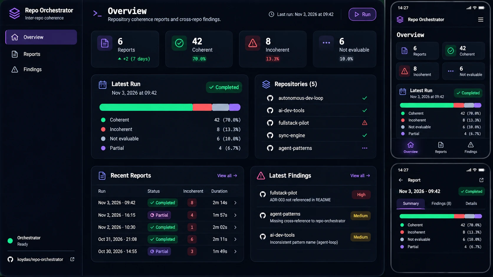
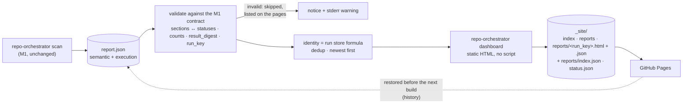

# Report dashboard

> **Status: implemented.** A static, read-only viewer for the `report.json` files that `scan` writes. It evaluates nothing, adds no service and no dependency. Decisions: [ADR-0012](../adr/0012-static-report-dashboard.md), [ADR-0014](../adr/0014-finding-actions-as-human-submitted-drafts.md) (Proposed).



## The mockup is a reference, not a specification

The image above is the **visual** reference (dark navy `#0a0f1d`, cards `#111a2c`, accent `#7c5cff`, compact density, the same family as the [`autonomous-dev-loop`](https://github.com/koydas/autonomous-dev-loop) and [`ai-dev-tools`](https://github.com/koydas/ai-dev-tools) dashboards). It shows things M1 does not produce, which are therefore **not** implemented:

| In the mockup | In the dashboard |
|---|---|
| "70.0% coherent", segmented coherence bar | Not implemented. Outcomes are counted per status; no ratio, no score. |
| "+2 (7 days)" trend on Reports | Not implemented. No longitudinal metric exists in M1. |
| "Run" button | Not implemented. The dashboard never starts a scan. |
| Findings page, "Not evaluable"/"Partial" as outcome categories | Findings are the confirmed `inconsistent` outcomes of a run, inside the report. `partial` is a **run** status, not an outcome status. |
| Per-repository ✓ / ⚠ / … | Replaced by the pinned commit of each repository and the number of findings that affect it. |
| "High / Medium" chips | Kept: the report's own `severity`. |
| Sidebar, page tabs (Summary / Findings / Details) | Replaced by a top navigation, an in-page jump row and a phone tab bar. |

## Views

| View | File | Contents |
|---|---|---|
| Overview | `index.html` | Latest run: status line, outcome counts, the seven statuses, repositories at their pinned commit, the last three findings, recent reports, link to the detailed report. |
| Reports | `reports.html` | Every report, newest first: execution date, run status, confirmed inconsistencies, `cannot_evaluate`, link. Cards on a phone, a table from 760 px. |
| Report | `reports/<run_key>.html` | Run summary; **Findings** in the report's own order (severity, affected repositories, fingerprint) with policy and relationship ids, explanation, affected repositories, comparison, open questions, where to fix, what to investigate, expandable evidence with links to the pinned file and lines, expandable technical metadata; **other outcomes** by category; technical details (inputs, revisions, coverage, open questions, authorities, exceptions, execution metadata, run-store history). |

Semantics preserved:

- `policy_clarification`, `policy_conflict`, `excepted`, `cannot_evaluate` and `failed` are **never** drawn as confirmed inconsistencies; red is reserved for `inconsistent`. A report that files another status under `findings` is rejected.
- The **run status** (`complete` / `partial`) is an outlined badge, distinct from outcome badges. A partial run says it may be missing findings and that an absent finding is **not** resolved.
- A finding's **evidence verification** (quotes re-checked in code) and **conclusion validation** (`validated_by_check`) are two separate labels. There is no confidence score.
- Run-store history (`execution.history`) is shown when present; a report written with `--no-store` says "not recorded". Nothing is inferred.

## Finding actions

Each finding shows **Open issue**, **Create prompt** and **Create PR** ([ADR-0014](../adr/0014-finding-actions-as-human-submitted-drafts.md)). They are drafts: the dashboard creates, posts and pushes nothing.

| Action | What it is |
|---|---|
| Open issue | Link to the target repository's *new issue* form, title and body pre-filled from the report, with the neutral label `repo-orchestrator` (never a pipeline label). You submit it. |
| Create prompt | The finding plus instructions, in an expandable block to select and paste into an agent session. It asks for a commit on `repo-orchestrator/<fingerprint>`, pushed, and no PR. |
| Create PR | Link to the *compare* form for that branch, pre-filled. Works once the branch is pushed. |

Target repository: first fix site, else first affected repository. None resolvable: no actions. Only confirmed findings get actions.

## Data flow



The store (`state.sqlite`) is not an input: it is local and holds no semantic report. History is the set of reports the site publishes.

## Use

```bash
repo-orchestrator scan --output-dir reports/2026-11-03      # one directory per run keeps history locally
repo-orchestrator dashboard --reports reports --out _site   # reads every report.json under reports/
python -m http.server -d _site                              # or open _site/index.html
```

`dashboard` exits 0 (files it cannot use are warned about on stderr and listed on the pages) or 3 when `--reports` does not exist. It overwrites and never deletes: build into a fresh directory.

## Deployment (GitHub Pages)

`.github/workflows/dashboard.yml`, manual (`Actions → Report dashboard → Run workflow`), one-time setup *Settings → Pages → Source: GitHub Actions*:

| Input `scan` | Effect |
|---|---|
| `none` (default; also on push to `main` when the generator changes) | Rebuild from the published history. With no history, the empty state. |
| `baseline` | Adds the offline report of the pinned baseline (fixtures, no network). |
| `live` | Adds a read-only scan of the six public repositories with the workflow's `GITHUB_TOKEN` (`contents: read`). |

Each run downloads the files listed in the live site's `reports/index.json` (names validated as 32 hex characters), adds the new report, builds, and republishes everything. No schedule, no write token, no branch.

## Design conventions shared with the sibling dashboards

Colour tokens (light and dark by `prefers-color-scheme`, no toggle), the 30 px brand mark, header with companion links, phone tab bar, rounded cards, pills, compact 14 px type, static HTML with no script ([ADR-021](https://github.com/koydas/ai-dev-tools/blob/main/docs/adr/ADR-021-uniform-dashboards.md)). Phone layout targets 375 px: stacked cards, report table turned into cards, no horizontal scroll. Content is centred up to 1160 px.

## Limits

- The Pages site **is** the history. A failed restore shortens it, and deleting the site loses what was not kept elsewhere.
- No retention policy; each distinct run adds about 300 KB.
- Reports from CI have no run-store history (`--no-store`).
- The page shell is a copy of the siblings' tokens, kept in step by hand.
- Responsive and theme behaviour were checked in Chromium at 375, 768, 1366 and 1920 px in both schemes (no horizontal overflow); there is no browser test in CI, by choice: no new dependency.
