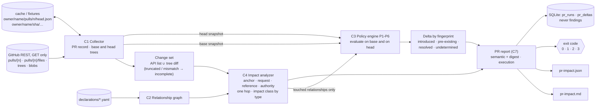

# M2: PR impact analysis

> **Status: implemented.** M2 adds C4 (impact analyzer) and W2 (cross-repository PR analysis) to the M1 package: given one pull request of one of the six declared repositories, it reports which other repositories the change can break, falsify or outdate, and whether it **introduces**, **leaves untouched** or **resolves** each finding. Read-only, deterministic, no LLM, no GitHub write; `analyze-pr` is unchanged by M3 (the investigation runs in `scan --investigate` only). M4–M5 are **not** implemented ([MVP](../mvp.md)). Decision record: [ADR-0013](../adr/0013-m2-pr-impact-contracts.md) (Proposed).

| Page | Contents |
|---|---|
| [Usage](usage.md) | `repo-orchestrator analyze-pr`, options, exit codes, the gate rule, offline use, permissions |
| [Impact model](impact-model.md) | Change set, anchoring, direction and impact class, delta labels, what is evaluated |
| [Report format](report-format.md) | The PR report (Markdown and JSON), run store tables, schema versioning |
| [Evaluation](evaluation.md) | U1–U5 replayed as pull requests, the missing-evidence cases, results |
| [Limitations](limitations.md) | What M2 does not do and where its answers can be wrong |
| [Examples](examples/u1-introduced.md) | Generated reports checked by a test: [U1 introduced](examples/u1-introduced.md) ([JSON](examples/u1-introduced.json)), [U5 pre-existing](examples/u5-raw-pre-existing.md), [truncated list](examples/truncated-incomplete.md) |

## Data flow as implemented

One Python process, one SQLite file, no service. Policy evaluation reads only frozen snapshots; all network access stays inside the collector package. Nothing is written to GitHub.

## Package map (M2 additions)

| Module | Role |
|---|---|
| `collector/pr.py`, `collector/github.py`, `collector/cache.py` | C1 PR boundary: `PullRequest`, GET `pulls/{n}` and `pulls/{n}/files`, the versioned offline record |
| `impact.py` | C4: footprints, touched relationships, direction, impact class, changed values |
| `delta.py`, `lifecycle.py` | Base/head classification by fingerprint; the vanishing rule shared with the run store |
| `pr_runner.py` | W2 as one function: resolve, pin, change set, C4, evaluate touched, delta, persist |
| `pr_report.py` | PR report: semantic part, gate, exit code, Markdown |
| `engine.py` (small change) | `RunOptions.relationships`: evaluate only the selected relationships |
| `store.py` | `pr_runs`, `pr_deltas` (a separate run kind) |
| `cli.py` | `analyze-pr` |
