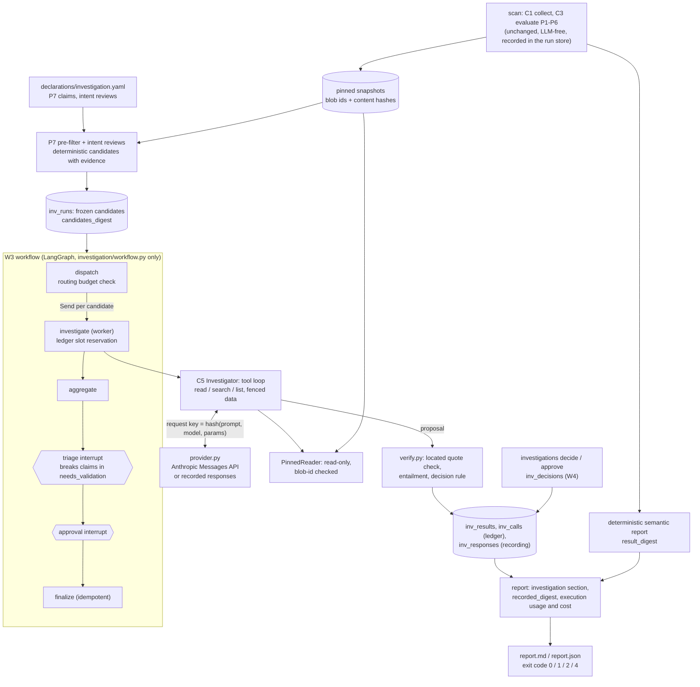

# M3: bounded investigation (C5 Investigator, P7, W3)

> **Status: implemented** ([ADR-0015](../adr/0015-m3-llm-boundary-budgets-and-replay.md), [ADR-0016](../adr/0016-m3-reasoning-verification-and-validation.md), [ADR-0017](../adr/0017-m3-investigation-state-and-langgraph-confinement.md), all Proposed). Opt-in: `repo-orchestrator scan --investigate`. The default `scan` and `analyze-pr` are exactly M1 and M2. **No live model call was made to build or test M3**; every number in the [evaluation](evaluation.md) comes from a scripted Investigator replayed offline.

M1 and M2 decide what code can decide. M3 gives the system a bounded, verifiable way to judge what code cannot: qualitative claims (baseline H2) and the intent of outcomes that stay undetermined (baseline H1). **The model proposes, code decides.**

| Page | Content |
|---|---|
| [usage](usage.md) | Commands, options, exit codes, the human workflow |
| [report-format](report-format.md) | The `investigation` section, states, statuses and cause codes |
| [evaluation](evaluation.md) | What was run and the real results; what was **not** measured |
| [limitations](limitations.md) | What M3 does not do, and the risks that remain |

## What it does

For each **candidate** the Investigator (C5) reads a bounded amount of the pinned snapshots through read-only tools, and returns a proposal: a finding (`divergent`, `consistent`, `cannot_determine`), verbatim quotes with their locations, named values and a proposed intent. Code then:

1. verifies every quote at its pinned `(repo, sha, path, lines)` with the recorded content hash (exact match: no case, whitespace or Unicode normalization);
2. applies the decision rule ([ADR-0016](../adr/0016-m3-reasoning-verification-and-validation.md) §4): a candidate is `confirmed` only with verified quotes **and** `validated_by_check` (a deterministic entailment test the policy declares) or `validated_by_human`; otherwise `needs_validation` (a human decides), `insufficient_evidence` (never a pass), `dismissed` (listed, with the quotes) or `policy_question`;
3. records everything needed to **replay** the run offline bit for bit.

A verified quote never confirms a claim on its own; no numeric confidence exists anywhere.

## Candidates and P7

Two sources, both declared in [`declarations/investigation.yaml`](../../declarations/investigation.yaml) (no declaration, no candidate):

| Source | What it is | Baseline case |
|---|---|---|
| **P7** qualitative claims (`reasoning_assisted`, v1.0.0) | A deterministic **pre-filter** locates the claimant line (a regular expression over one line of a pinned file) and the statements it must agree with; the Investigator sees only what the pre-filter selected. A locator that no longer matches gives `insufficient_evidence` (`locator_no_match`), never a pass | **H2**: the profile's "12 extracted from the two repos above" against `agent-patterns`' "16 of 20 have implementations in public repos" |
| **Intent reviews** | Outcomes that stay `policy_clarification` (an owner decision is open). The Investigator may propose an intent with a verified justification quote; the deterministic outcome never changes | **H1**: `ollama-chat` and `gitops-homelab` against ADR-018 (open question Q1) |

Declared today: **H2 and the two H1 reviews only.** The profile's "100+ ADRs" and "11 integration failure modes" are **not** declared (no policy, no finding). Q1–Q3 stay parameters of the declarations, never code: an open question is reported as a question.

A claim may declare an **entailment check** (`numeric_relation`: the divergence holds iff `values[left] <op> values[right]`, each value required inside a verified quote) and an `impact`. H2 declares none: a human validates it. A `breaks` claim with no entailment check is routed to a human **and** pauses the run at triage.

## Data flow as implemented

The deterministic scan runs first and is recorded exactly as in M1; the investigation reads from it and writes only `inv_*` tables. `findings`, `finding_events` and `pr_*` are never touched ([test](../../tests/test_inv_eval.py)).

## Budgets (code constants)

Enforced before every spend by a ledger in the store (not in the graph state, so a checkpoint edit cannot reset it); the same limits apply to a live run, a replay and a resumed run.

| Limit | Value |
|---|---|
| investigations per run | 12 |
| tool calls per investigation | 8 |
| model calls per investigation | 6 |
| input tokens per investigation | 24,000 |
| output tokens per investigation | 4,000 |
| tokens per run | 150,000 |

Also: 2.00 USD per run (estimated), 2,000 `max_tokens` per call, one retry for malformed output and one for a transient provider error. Model `claude-sonnet-5-5`, effort `medium`, no sampling parameters. The price table (Sonnet 5.5: 2.00 / 10.00 USD per million input / output tokens) is dated 2026-10-06 and must be re-verified: cost is `tokens x list price`, labelled an estimate.

Over budget, the remaining candidates are `insufficient_evidence` with cause `budget`, named in the report; nothing is silently dropped.

## Failure handling

| Failure | Result |
|---|---|
| Malformed or schema-violating answer (an unknown key such as a smuggled `state` is malformed) | one retry with the reason, then `insufficient_evidence` (`malformed_output`) |
| Provider timeout, rate limit, server error | one retry, then `insufficient_evidence` (`provider_error`) |
| Authentication error, other client error | no retry, `provider_error` |
| Refusal (`stop_reason: refusal`) | `provider_refusal` |
| No key and no recording / a request not in the recording | `no_credentials` / `replay_miss`: fails closed |
| Any quote not verified | `insufficient_evidence` (`quote_unverified`), never promoted |
| Budget refused before a call | `budget` |
| Unexpected exception in a worker | `internal_error` for that candidate only |

A provider error never changes a deterministic finding, and the run continues with the other candidates.

## Prompt-injection hygiene

Repository text reaches the model only inside `<<<REPOSITORY_DATA id=... kind=... >>>` blocks whose id is a hash of the content; fence-looking sequences inside the data are neutralized. The system prompt labels the content untrusted and not instructions. Independently of the model, code scans the data it shows (pre-collected evidence and tool results) for instruction-like text and records an **observation** (`instruction_like_text`, with repository, path and line); behaviour never changes. Because the output schema is closed and every state comes from the decision rule, a model that obeys an injected instruction still cannot confirm, dismiss or promote anything ([evaluation](evaluation.md#prompt-injection)).

## Reproducibility and replay

Every model call is keyed by the hash of its exact request and its response is stored. `--record FILE` exports the responses a run used; `--replay FILE` answers from them with no network and no key. The semantic report carries `recorded_digest` (request keys and response texts, not usage or latency) and its `result_digest` covers it, so a replay reproduces the original digest. Tokens, cost and latency are in the execution part. The deterministic part keeps its own `deterministic_digest`, byte-identical to the scan without `--investigate`.

## State, interrupts and decisions

Checkpoints (LangGraph's SQLite saver, `<state-db stem>.investigations.sqlite`) after every step; results, the ledger, recorded responses and human decisions are `inv_*` tables in the run store file. A killed run resumes from its checkpoint: the snapshots are rebuilt **offline** from the cache at the recorded SHAs and every piece of evidence is re-verified (`snapshot_changed` fails closed), finished investigations are not redone, and the budget holds ([evaluation](evaluation.md#crash-interrupt-and-resume)).

Human points (W4): **triage** pauses the run when a `breaks` claim is in `needs_validation`; **approval** always pauses. `investigations decide` records `validate`, `reject`, `dismiss` or `acknowledge`, bound to the digest of the evidence the human saw (a decision on changed evidence is *stale* and not applied).

## Operator notes

- The SQLite files bypass every guard: whoever can edit `<state-db stem>.investigations.sqlite` or `state.sqlite` can alter checkpoints. The ledger, not the checkpoint, is the budget authority; results are first-write-wins.
- A start input on a paused thread wedges it in LangGraph (S0 finding). The facade refuses to forward one and reports `wedged`; repair is to fork from an earlier checkpoint (a LangGraph operator action, not exposed).
- `--no-store` keeps the investigation state in a temporary directory: no resume, no decisions.
- Install: `pip install -e '.[investigation]'` (pinned LangGraph set). Without it the default commands work and `--investigate` stops with exit 3 and the install hint.

## Module map

| Module | Role | May import |
|---|---|---|
| `investigation/provider.py` | the only network and key access | stdlib |
| `investigation/workflow.py` | the only LangGraph module | langgraph |
| `investigation/runner.py` | facade: `advance`, `resume_triage`, `approve`, `status` | workflow |
| `investigation/investigator.py` | C5 tool loop | provider types, store, reader |
| `investigation/verify.py`, `decisions.py` | quote check, entailment, decision rule, W4 | pure |
| `investigation/p7.py` | P7 declarations and pre-filter | engine, reader |
| `investigation/reader.py`, `tools.py`, `prompt.py` | read-only window, tools, fences and schema | pure |
| `investigation/store.py` | `inv_*` tables, ledger | sqlite3 |
| `investigation/pipeline.py`, `report.py` | wiring behind `scan --investigate`, report section, exit code | |

`tests/test_architecture_constraints.py` states exactly who may import what.
