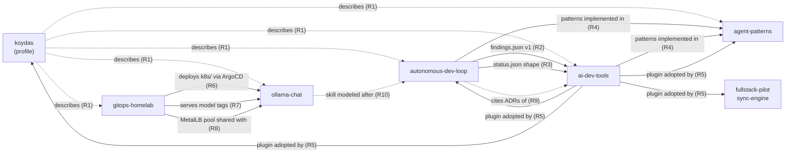

# Ecosystem baseline

What six `koydas` repositories say about each other, as of the revisions below. This page is the evidence base for the design: every scenario in the README and every MVP policy in [`mvp.md`](../mvp.md) traces to an entry here.

## How to read this page

| Label | Meaning |
|---|---|
| **VERIFIED** | Read in the source at the cited revision. The claim is what the file says, nothing more. |
| **HYPOTHESIS** | A reasonable architectural reading that the sources do not settle. Needs the owner's confirmation or a check this page did not run. |
| **ILLUSTRATIVE** | A future use case. Not an observation. |

A VERIFIED *inconsistency* is a contradiction between two files that both exist at the cited revisions. A VERIFIED *consistency* is recorded on purpose: it is a negative control for the MVP evaluation (a policy that flags it is producing a false positive).

Line numbers refer to the cited revision and drift with later commits; the revision is the stable reference.

## Method and limitations

- Each repository was shallow-cloned at its default branch HEAD on 2026-10-31 and read with plain text tools (`grep`, `ls`, file reads). No code was executed, no tests were run, no GitHub API state (issues, PRs, labels, Actions runs, published Pages) was read.
- Published artifacts (the `findings.json` and `status.json` served on GitHub Pages) were **not** fetched. Statements about them come from the code that produces and consumes them.
- Counting claims (ADRs, patterns, incidents) were checked by counting files or headings. The counting rule is stated each time, because "how many ADRs" is itself a policy decision (see [coherence model](../coherence-model.md#counting-claims)).
- `fullstack-pilot` and `sync-engine` were not in the requested scope. They appear only where a primary-scope file names them (ai-dev-tools ADR-018).
- The search was targeted (cross-repository names, contracts, shared resources), not exhaustive. Absence of a finding here is not evidence of coherence.

## Revisions

| Repository | Scope | Revision | Commit date |
|---|---|---|---|
| `koydas/autonomous-dev-loop` | primary | `1607f6107b1f50f4e9baa1916a187c7bc16ca18a` | 2026-10-30 |
| `koydas/ai-dev-tools` | primary | `62f30ed888201deb713126db90975983c4d6fab0` | 2026-10-30 |
| `koydas/agent-patterns` | primary | `6d00841fc67d0dbeb3e35e7c2109d201b3979925` | 2026-10-27 |
| `koydas/koydas` | primary | `c43e48bbb4ce6b70ae70e8652ef05f64a23fcadb` | 2026-10-30 |
| `koydas/gitops-homelab` | secondary | `a8a9d7db5e725fd47061e8ae7fbfa70d81be3603` | 2026-10-02 |
| `koydas/ollama-chat` | secondary | `1693c3f791a6ebe8dae2cfb90ccc4b168327ae0e` | 2026-10-19 |

Short forms below: `adl`, `adt`, `ap`, `profile`, `homelab`, `chat`, followed by `path:line`.

## Relationship map (verified edges only)

Solid edges carry a machine-checkable contract; dotted edges are documentary or conceptual. This distinction drives the relationship types in the [domain model](../domain-model.md#relationship-types).

## Verified relationships

| ID | Relationship | Type | Evidence |
|---|---|---|---|
| R1 | The profile README describes five repositories with counts and a relationship diagram, and its `CLAUDE.md` makes the counts a rule: "Repo descriptions in the README must match the repos' own READMEs (counts of ADRs/tests/patterns drift)." | documentary | `profile CLAUDE.md:3`; `profile README.md:11,13,19,44-47` |
| R2 | `findings.json` is produced by `adl` and consumed by `adt`'s `/loop-insights`. Producer constant `FINDINGS_SCHEMA_VERSION = 1`; consumer constant `SUPPORTED_SCHEMA_VERSION = 1`, rejects any other value. Consumer source URL `https://koydas.github.io/autonomous-dev-loop/findings.json`. The contract is decided on both sides: adl ADR-0046/0047, adt ADR-017. | contract (data) | `adl scripts/lib/findings_export.mjs:6`; `adt scripts/loop-insights.mjs:13,110`; `adt configs/meta-loop.yaml:3`; `adt docs/adr/ADR-017-loop-insights-command.md` |
| R3 | `status.json`: `adt`'s dashboard writes `{schema_version: 1, app, generated_at, status, headline}` with the comment "same shape as autonomous-dev-loop's"; `adl` writes the same five keys with `STATUS_SCHEMA_VERSION = 1`. No shared schema file exists; the shape is kept equal by convention. | contract (data) | `adt scripts/build-dashboard.mjs:168-171`; `adl scripts/lib/findings_export.mjs:48,62` |
| R4 | `ap` names `adl` and `adt` as where its patterns run ("16 of 20 have implementations in public repos"). | conceptual + documentary | `ap README.md:5,30-44` |
| R5 | `adt` ADR-018: every repository worked on with Claude Code declares the plugin in `.claude/settings.json`, "exactly the two keys of ADR-013 §2. The file is identical across repos." `adl`, `ap`, `profile` (and `fullstack-pilot`, `sync-engine`) carry both keys. `adt docs/consumer-repos.md` lists the adopters and their skills; the list matches the skill directories found. | tooling | `adt docs/adr/ADR-018-consumer-repo-adoption.md:12`; `*/.claude/settings.json`; `adt docs/consumer-repos.md` (Current adopters) |
| R6 | `homelab` deploys `chat` through an ArgoCD Application with a git source on `chat`'s `k8s/` directory. Both repositories record the decision: homelab ADR-0015, chat ADR-0006. `chat`'s CI commits the image tag into `k8s/deployment.yaml`, which ArgoCD then syncs. | deployment | `homelab apps/ollama-chat/application.yaml:9`; `homelab apps/appproject.yaml:14,29`; `homelab docs/adr/0015-*.md`; `chat docs/adr/0006-gitops-deployment-via-ghcr.md` |
| R7 | `chat` hard-codes `TEXT_MODEL = 'llama3.1:8b-instruct-q4_0'` and `VISION_MODEL = 'llava:7b'` with no runtime existence check (chat ADR-0009); `homelab` pulls exactly these tags and its manifest comments name `chat`'s `VISION_MODEL` as the consumer. | contract (runtime) | `chat src/lib/conversations.js:16-17`; `homelab apps/ollama/application.yaml:49-61` |
| R8 | One MetalLB pool `192.168.1.240-250` is defined in `homelab`; addresses are claimed in both repositories: `.243` ingress-nginx and `.245` Whisper in `homelab`, `.244` in `chat`'s own `k8s/service.yaml`. `homelab` documents the full allocation (`.240`–`.246`) only in prose and diagrams. | shared resource | `homelab apps/metallb-config/ipaddresspool.yaml:8`; `homelab apps/ingress-nginx/application.yaml:24`; `homelab apps/whisper/service.yaml:9`; `chat k8s/service.yaml`; `homelab docs/architecture.md:75-81` |
| R9 | `adl docs/autonomy-levels.md` maps its Level 2 stages to `adt` agents and links `adt` ADR-001, ADR-002, ADR-009 by URL. All three files exist at the `adt` revision above. | documentary | `adl docs/autonomy-levels.md:51-57` |
| R10 | `chat`'s `new-adr` skill states it is "modeled after" `adl`'s `new-adr` skill and lists what it deliberately omits (the changelog gate). | conceptual | `chat .claude/skills/new-adr/SKILL.md:80` |
| R11 | `adl` ADR-0039 is a LangGraph prototype of the bounded auto-fix loop (Python, `langgraph==1.2.15`, not wired to any workflow). It is the only use of LangGraph in the ecosystem. | conceptual (precedent) | `adl docs/adr/0039-langgraph-bounded-autofix-prototype.md`; `adl prototypes/langgraph-loop/` |

## Verified inconsistencies

| ID | Inconsistency | Evidence | Notes |
|---|---|---|---|
| D1 | The profile says `agent-patterns` has **17** patterns; `ap` says **20**, and `ap/patterns/` holds 20 directories. Violates the profile's own rule (R1). | `profile README.md:13` vs `ap README.md:3` and `ls ap/patterns` | Clear descriptive drift. Fix site: `profile`. |
| D2 | The profile says `autonomous-dev-loop` has **59 ADRs**. `adl`'s own README also says **59 ADRs**, but `adl docs/adr/` holds **65** numbered ADR files (0001–0065) and the index lists 65. | `profile README.md:11`; `adl README.md:19`; `adl docs/adr/README.md` | The profile **satisfies** its rule (it matches `adl`'s README); the root cause is upstream, inside `adl`. A naive cross-repo check blames the wrong repository. Fix site: `adl README.md`, then `profile`. Whether superseded/proposed ADRs count is a counting-rule question. |

## Verified consistencies (negative controls)

| ID | Claim checked | Evidence |
|---|---|---|
| C1 | Profile: `gitops-homelab` has 25 ADRs → `homelab docs/adr/` holds 25 numbered files. | `profile README.md:19` |
| C2 | Profile: 13 incidents → `homelab docs/runbook.md` "Incidents Hit While Building This" has 13 `###` entries. | `homelab docs/runbook.md:129` |
| C3 | `findings.json` producer and consumer versions are equal (R2). | see R2 |
| C4 | `status.json` keys are equal on both sides (R3). | see R3 |
| C5 | Both model tags used by `chat` are pulled by `homelab` (R7). | see R7 |
| C6 | No duplicate MetalLB address among the claims found; all lie inside the pool (R8). | see R8 |
| C7 | The three `adt` ADRs linked from `adl` exist (R9). | see R9 |
| C8 | `adt`'s adopter table matches the skills present in each adopter (R5). | see R5 |
| C9 | The profile claim "2,400+ tests" for `adl` is a lower bound; an approximate count of `test(`/`it(` calls in `adl` exceeds it. Not drift, but not checkable deterministically without a counting rule (the count is approximate). | `profile README.md:11` |

## Divergences that look like drift but are not (or not yet)

These are the cases that justify "coherence is not uniformity". A system that reports them as defects is wrong.

| ID | Divergence | Reading |
|---|---|---|
| N1 | ADR file naming differs: `NNNN-title.md` (`adl`, `homelab`, `chat`), `ADR-NNN-title.md` (`adt`, `fullstack-pilot`, `sync-engine`). Status lines differ in format too. | Each repo's `new-adr`/`adr-new` skill defines its own format. No cross-repo consumer parses ADR filenames. **Not a meaningful inconsistency** until something consumes them across repos (this project would be the first: its extractors must accept both). |
| N2 | `adl/.claude/settings.json` holds `permissions` and `hooks` besides the two plugin keys, while ADR-018 says "The file is identical across repos." | The two plugin keys are identical; the extra keys are `adl`'s test gate, documented in `adl CLAUDE.md`. Literal reading: violation. Intent of ADR-018 (same plugin declaration): satisfied. **The policy text is ambiguous**, so the right output is a policy-clarification question, not a finding against `adl`. |
| N3 | `new-adr` procedures are duplicated in five repositories (`adl`, `chat`, `fullstack-pilot`, `sync-engine`, and `adr-new` in `homelab`). | Consolidation looks attractive, but `adt` ADR-018 §3 decides that skills belong to the consuming repository, never to the plugin. A consolidation proposal would contradict an accepted ADR. **Intentional duplication.** |
| N4 | `homelab` ADR-0015 (Accepted) says `ollama-chat` is routed through ingress "rather than getting its own MetalLB IP"; `chat` ADR-0007 later added a dedicated `.244`. | ADRs are point-in-time records. `homelab`'s living documents (`architecture.md:79`, `request-flows.md:37`) already show `.244`. **Not drift**: a policy must compare living documents, not accepted ADRs, unless an ADR is cited as current. Whether `homelab` should record a cross-repo amendment is an open question (Q4). |

## Hypotheses (need validation)

| ID | Hypothesis | Why it is not verified |
|---|---|---|
| H1 | `homelab` and `chat` are worked on with Claude Code (both have `.claude/skills/`) but do not declare the `adt` plugin. Either they are outside ADR-018's intended scope or they are missing adopters. | ADR-018's context lists five repositories; its rule says "every repository worked on with Claude Code". The owner must say which. |
| H2 | The profile phrase "12 extracted from the two repos above" may be stale against `ap`'s "16 of 20 have implementations in public repos". | "Extracted from" and "has an implementation in" are different claims; `ap` also says 11 patterns have a "Where it came from" section. No deterministic rule decides this: it needs semantic reading, then a human. A good candidate for bounded LLM investigation. |
| H3 | The MetalLB allocation has no single authoritative registry; a new claim in a third repository could collide without any check failing. | No collision exists today (C6). The risk is structural, not observed. |
| H4 | `findings.json` and `status.json` (R2, R3) have no shared schema artifact; a shape change on one side is caught only at runtime (`adt` exits non-zero on an unknown version) or not at all (`status.json` consumer behavior on a shape change was not read). | The consumer of `status.json` in `adt`'s dashboard was not traced end to end. |
| H5 | The "handoff packet" between `adl` Level 2 and `adt` Level 1 is described by `adl` as a contract that "belongs to a joint decision" across repositories, with no home for that decision. | `adl docs/autonomy-levels.md:79`. Whether cross-repository decisions need their own record location is a design question for this project (see [ADR-0003](../adr/0003-policy-driven-coherence-with-scoped-exceptions.md) open questions). |
| H6 | `adl` README's "59 ADRs" may count only Accepted ADRs at some earlier date rather than being stale. | The README does not state its counting rule. |

## Illustrative future use cases

| ID | Use case | Based on |
|---|---|---|
| U1 | A PR in `adl` bumps `FINDINGS_SCHEMA_VERSION` to 2. The system lists `adt scripts/loop-insights.mjs:13` as an affected consumer that will reject the export, and the order in which the two repositories must change. | R2 |
| U2 | A PR in `chat` changes `VISION_MODEL`. The system reports that `homelab apps/ollama/application.yaml` does not pull the new tag, and that the manifest comment naming the consumer becomes false. | R7 |
| U3 | A PR in `homelab` claims `192.168.1.244` for a new service. The system reports the collision with `chat k8s/service.yaml`. | R8, H3 |
| U4 | A PR in `adt` renames an ADR file. The system lists the URL in `adl docs/autonomy-levels.md` that will break. | R9 |
| U5 | A new pattern is added to `ap`. The system reports that the profile count is now stale, and that the profile rule (R1) makes it a defect there, not in `ap`. | R1, D1 |

## Unanswered questions

| ID | Question |
|---|---|
| Q1 | Which repositories are inside ADR-018's "worked on with Claude Code" scope (H1)? |
| Q2 | What is the counting rule for public ADR counts: all numbered files, Accepted only, or index entries (D2, H6)? |
| Q3 | Should ADR-018's "identical file" sentence be read as "identical plugin keys" (N2)? |
| Q4 | When a decision in repository B changes a fact recorded in an accepted ADR of repository A, does A record anything (N4)? |
| Q5 | Is there an owner-intended home for cross-repository decisions (H5)? |
| Q6 | Are private repositories ever in scope? This baseline only covers public ones. |

## Relation to `autonomous-dev-loop` ADR-0039

ADR-0039 asks whether a LangGraph state graph expresses **one repository's write loop** (generate → evaluate → fix, capped at 3) better than labels across workflows. This project asks a different question: whether a stateful, interruptible graph is the right shape for **read-only investigations that span repositories** and pause for human classification. The lessons that transfer are recorded in [ADR-0005](../adr/0005-langgraph-for-investigation-workflows-only.md): caps as code constants, a restricted input schema so a resumed thread cannot reset its budget, and deterministic verdicts.
