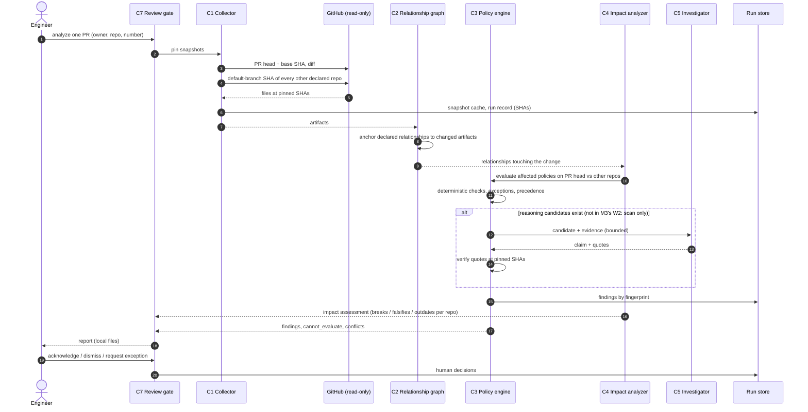
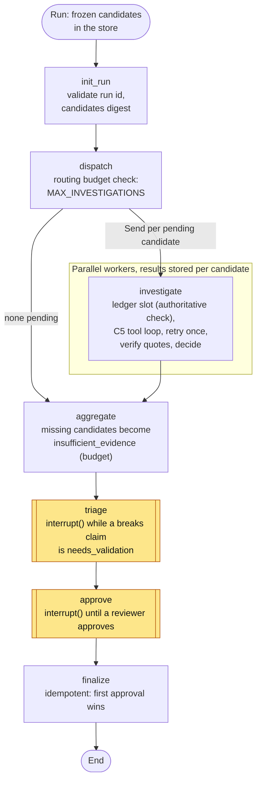

# Workflows

> **Status: W1 is implemented in M1** (`repo-orchestrator scan`, [usage](m1/usage.md)), **W2 in M2** (`repo-orchestrator analyze-pr`, [usage](m2/usage.md)) and **W3, the LangGraph workflow and the decision part of W4 in M3** (`scan --investigate`, `investigations ...`, [usage](m3/usage.md)). **W5 and W6 are proposed design**; their command names are placeholders. The investigation is **not** part of `analyze-pr` in M3.

Operational workflows, the LangGraph graph proposed for milestone M3, failure handling and human intervention points. Components C1–C7 are defined in [architecture.md](architecture.md#components).

| ID | Workflow | Trigger | Milestone |
|---|---|---|---|
| W1 | Baseline scan | Human runs it on the declared repositories | M1 (**implemented**) |
| W2 | Cross-repository PR analysis | Human runs it on one PR | M2 (**implemented**, without an investigation step: M3 did not extend it) |
| W3 | Bounded investigation | Inside W1 (`scan --investigate`), for reasoning candidates | M3 (**implemented**; W2 not extended) |
| W4 | Triage and exceptions | Human, on a report | M1 (manual exceptions), M3 (**implemented**: decisions and approval in the graph) |
| W5 | Remediation planning | Inside W1/W2, for confirmed findings | M4 |
| W6 | Opportunity assessment | Human runs it, from findings history and declared relationships | M5 |
| — | Scheduled scans, PR comments, coordinated issues/PRs | — | Deferred ([mvp.md](mvp.md#deferred)) |

## W1 Baseline scan

1. Load declarations; fail fast on invalid policies, same-scope conflicts or exceptions missing required fields.
2. C1 pins every declared repository at its default branch HEAD.
3. C2 builds the graph; observers propose `observed` relationships.
4. C3 evaluates every applicable policy on every relationship; transitions findings by fingerprint against the run store (new, unchanged, resolved, regressed).
5. C7 writes the report: findings by severity, `cannot_evaluate` list, policy conflicts, proposed relationships, opportunities, and the delta since the previous run.

No LLM call in M1–M2 or in the default `scan`; with `--investigate` step 4 is followed by W3 below. Expected cost: GitHub reads only (W1 about 50 requests; W2 is bounded by `--max-requests`, default 400, and its measured cost is recorded in the [M2 evaluation](m2/evaluation.md#live-read-only-analysis)).

**As implemented in M1** (`runner.run_scan`):

1. Declarations are loaded and every policy prepares and validates its configuration; invalid declarations, same-scope policy conflicts, unknown pins or exception references stop the command (exit 3) before anything is collected.
2. The engine derives the collection plan from the declared artifacts of the relationships to evaluate (plus policy and exception authorities); C1 resolves each repository (HEAD, a named pin set or `--pin`), lists its tree and fetches the planned artifacts into the cache.
3. C2 holds the declared graph. Observers are not implemented.
4. C3 verifies each policy's authority, evaluates every applicable policy on every evaluable relationship, then applies repository authorities and exceptions, re-verifies all evidence and computes fingerprints. The run store records the run and transitions findings by fingerprint (`new`, `unchanged`, `regressed`, `state_changed`, `resolved`, `not_evaluated`).
5. The report lists findings by severity, policy questions, conflicts, exceptions, cannot-evaluate and failures, the consistent relationships, the coverage of every declared relationship and the open questions; the exit code is 0, 1, 2 or 3. Proposed relationships, opportunities and the delta since the previous run (history is in the JSON `execution` part) are not rendered in the Markdown report.

## W2 Cross-repository PR analysis

Notes:

- The PR's repository is evaluated at the **PR head**; every other repository at its default-branch HEAD. A finding therefore means "merging this PR as-is makes this relationship incoherent", or "it already is" (pre-existing findings are labelled as such, so the PR is not blamed for them).
- Base-vs-head comparison: a finding present on base and head is `pre-existing`; present on head only is `introduced`; present on base only is `resolved by this PR`. `cannot_evaluate` on either side is `undetermined`, never `introduced` or `resolved` (M2 implements this).
- One hop by default ([architecture](architecture.md#c4-impact-analyzer)).

**As implemented in M2** (`pr_runner.analyze_pull_request`; the diagram above shows the full W2, of which M2 builds everything except C5 and the human acknowledgement):

1. The PR reference is resolved to a declared, analyzed repository (otherwise a configuration error, exit 3). C1 reads `pulls/{n}` and its files; the PR repository is snapshotted at its **base** and **head** (a missing PR, base or head is incomplete), every other repository at one SHA resolved once.
2. The changed paths are the API list (with rename sources) united with the tree difference; a truncated list or a difference the list does not explain is incomplete.
3. C4 maps the changed paths to relationships (anchor, policy read, P5 link target, authority; one hop), classifies the impact by relationship type and lists the changed values.
4. C3 evaluates **only the touched relationships**, on base and on head. Findings are labelled by fingerprint: `introduced`, `pre-existing`, `resolved`, or `undetermined` when a side could not be evaluated ([impact model](m2/impact-model.md#6-delta-labels-by-fingerprint)).
5. C7 writes `pr-impact.md` and `pr-impact.json` and records a separate run kind in the store (`pr_runs`, `pr_deltas`; baseline finding history untouched). Exit code: 0 no introduced finding, 1 introduced finding, 2 incomplete, 3 failure. **A pre-existing finding never fails the gate by itself.**
6. No investigation (M3 did not extend W2), no PR comment, no write of any kind: the report is local files.

## W3 Bounded investigation (`scan --investigate`)

**As implemented in M3** (`investigation/pipeline.run_investigation`, [docs](m3/README.md)):

1. The deterministic scan runs and is recorded exactly as in M1. Its report is the base of the investigated one.
2. Candidates are built by code from `declarations/investigation.yaml`: the P7 pre-filter locates each declared claim and the statements it must agree with in the pinned snapshots (a locator that no longer matches is `insufficient_evidence`, not a pass); intent reviews take the undetermined outcomes (H1). They are frozen in the store (`candidates_digest`) under a run id derived from the inputs.
3. The workflow below runs: one worker per candidate, each reserving its slot in the ledger, then a bounded tool loop with the Investigator ([architecture](architecture.md#c5-investigator)).
4. C3-side code verifies every quote at its pinned location, runs the entailment check when the policy declares one and applies the decision rule ([ADR-0015](adr/0015-m3-reasoning-verification-and-validation.md)).
5. A `breaks` claim in `needs_validation` pauses the run at **triage**; every run pauses at **approval**. Decisions are recorded with `investigations decide` / `approve` ([usage](m3/usage.md#human-workflow-w4)).
6. The report gains the `investigation` section; exit codes 0/1/2/3 as before plus 4 (a human decision is pending). Responses are recorded; `--replay` reproduces the run offline.

## LangGraph workflow

Validated first by the isolated S0 spike ([ADR-0005](adr/0005-langgraph-for-investigation-workflows-only.md) §5; [results](../prototypes/langgraph-spike/docs/results.md)) and **implemented in M3** in `src/repo_orchestrator/investigation/workflow.py`, the only module that imports LangGraph ([ADR-0016](adr/0016-m3-investigation-state-and-langgraph-confinement.md)). The graph is new code on the S0 design, with its constraints applied (one facade, budget authority and effects outside the checkpoint, no side effect before `interrupt()`, workers catch every exception, `durability="sync"`, pinned dependencies). Pinning the snapshots, building the relationship graph and evaluating the policies stay in the plain-Python pipeline that precedes the graph; the graph starts from frozen candidates.

| Element | Rule as implemented |
|---|---|
| State | Run id (the only start input), phase, candidate keys, per-candidate result summaries. Candidates, results, the ledger and decisions are in the store, not in the checkpoint, so state edits cannot reset a budget or an outcome. |
| Fan-out | `Send` per pending candidate, capped by `MAX_INVESTIGATIONS` at routing and again in the worker (ledger). Investigations are independent: a worker catches every exception. |
| Retries | Inside C5 (not graph loops): one retry for malformed output, one for a transient provider error. No retry on an unverified quote. |
| Checkpoints | After every step (`durability="sync"`); results are written as soon as an investigation ends. A resumed run rebuilds the snapshots offline at the recorded SHAs, re-verifies the evidence and never repeats a finished investigation. |
| Human points | `triage` (a `breaks` claim in `needs_validation`; the run cannot pass it until it is decided) and `approve` (always). Approval records the reviewer and marks the run reviewed; in the MVP nothing is published outside local files and the store. |
| Termination | No loop: each candidate is investigated at most once per run; budgets are checked at routing and spent through the ledger. |

**Still proposed (not implemented):** `classify_intent` as a graph node with exceptions and precedence (exceptions are applied by C3 before the graph), `plan_remediation` (M4), `assemble_report` as a node, and the loop from `approve_report` back to classification.

## Insufficient evidence

A candidate ends in `insufficient_evidence` when: a quote cannot be verified (`unverified`), a needed file cannot be read, the Investigator's budget runs out, or its output stays malformed after one retry (**implemented in M3**, with cause codes: [report format](m3/report-format.md#cause-codes-cause)).

- It is **listed in the report** with the reason and what evidence would settle it. It never becomes a confirmed finding by default, and it is never silently dropped.
- It does **not** interrupt the run (batched, default proposed in ADR-0005; **implemented that way**). It makes the run incomplete: exit 2. A human can dismiss it, or add a declaration (a relationship anchor, a counting rule) that lets the next run decide it.
- The ratio of `insufficient_evidence` to candidates is an evaluation metric ([mvp.md](mvp.md#evaluation)).

## W4 Triage and exceptions

| Human action | Effect |
|---|---|
| Validate a reasoning claim (**M3**: `investigations decide --action validate`) | `needs_validation` → `confirmed` (`validated_by_human`); `reject` → `dismissed` with reason |
| Acknowledge (**M3**: `--action acknowledge`) | `confirmed` → acknowledged (recorded flag; the lifecycle state `acknowledged` of the deterministic findings is M4) |
| Dismiss with reason (**M3**: `--action dismiss`) | `insufficient_evidence` / `needs_validation` / `policy_question` → `dismissed`; the reason is stored and counts as a false positive in evaluation |
| Request an exception | Produces an exception draft in the report; the human adds it to the declarations by pull request; the next run marks the finding `excepted` |
| Clarify a policy | For policy conflicts and ambiguous authorities (baseline N2): a change to policy parameters by pull request |

## W5 Remediation planning (M4)

For each confirmed finding (or group sharing a relationship):

1. **Fix site** from the policy: for D2-type findings, the upstream repository first, then the describing one.
2. **Order** from relationship semantics: `runtime_contract` version bumps change the consumer to accept both versions first, then the producer, then remove the old version; `deployment` changes publish the artifact before the manifest points to it.
3. **ADR compatibility**, in three tiers ([coherence model](coherence-model.md#adr-compatibility)): formalized constraints checked in code; candidate semantic conflicts proposed by C5 with verified quotes; ADRs not examined, listed by name. The report says "no conflict detected among …", never "compatible". A plan with an unresolved candidate conflict cannot be approved (fail-closed): the human dismisses the conflict with a reason, or the owning repository records a superseding decision.
4. **Prevention**: a deterministic policy here and/or a recommended check in the owning repository.
5. Output: text in the report. Nothing is created on GitHub.

## W6 Opportunity assessment (M5)

Follows the lifecycle of [ADR-0009](adr/0009-optimization-opportunities-as-first-class-output.md): discover candidates from findings history, declared shared contracts and guardrails recorded in source repositories → attach pinned benefit evidence (discard if none) → assess benefit, cost, risk and new coupling → check ADR compatibility in the same three tiers as W5 → propose → human accepts, declines (reason kept, not re-proposed) or defers. Read-only; an accepted opportunity becomes a plan like W5.

## Failure handling

| Failure | Behavior |
|---|---|
| Invalid declarations | Stop before any GitHub call; report the declaration errors. |
| Repository unreachable or SHA not found | Policies touching it are `cannot_evaluate`; other repositories proceed; the run is marked partial. |
| Extractor parse error | `cannot_evaluate` for that policy and relationship, with the parse error. Never `pass`. |
| LLM provider error (M3, **implemented**) | A transient error is retried once, then `insufficient_evidence` (`provider_error`); deterministic findings are unaffected. |
| Budget exhausted | Remaining candidates `insufficient_evidence` with reason `budget`; the report says how many were not investigated. |
| Process killed (M3, **implemented**) | `investigations resume` / repeating the command continues from the last checkpoint; pinned SHAs and completed investigations are reused and the budget holds (tested with a real hard kill). |
| Prompt-injection text in a repository | Treated as data; if detected (instruction-like text in a quote), reported as an observation. |
