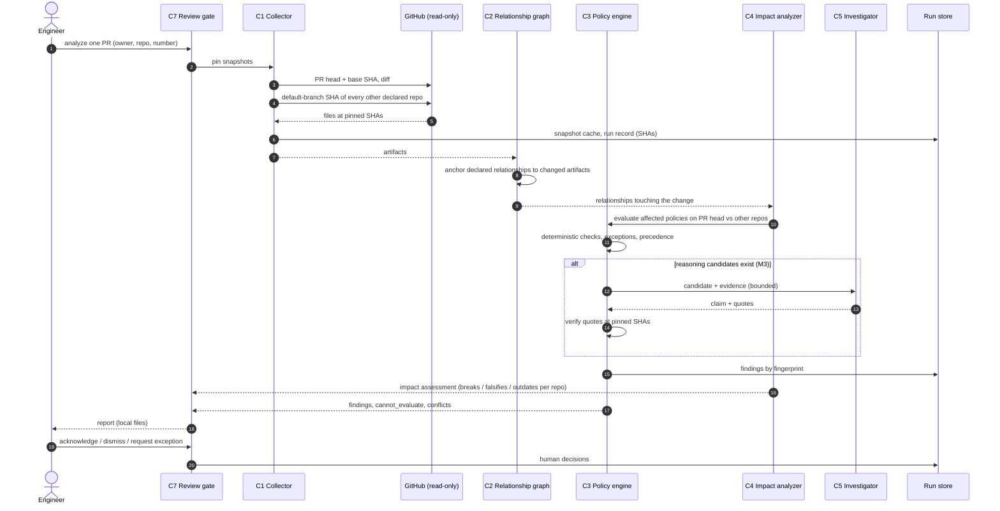
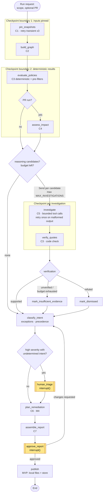

# Workflows

> **Status: proposed design. Nothing described here is implemented.** Command names are placeholders for the eventual interface.

Operational workflows, the LangGraph graph proposed for milestone M3, failure handling and human intervention points. Components C1–C7 are defined in [architecture.md](architecture.md#components).

| ID | Workflow | Trigger | Milestone |
|---|---|---|---|
| W1 | Baseline scan | Human runs it on the declared repositories | M1 |
| W2 | Cross-repository PR analysis | Human runs it on one PR | M2 |
| W3 | Bounded investigation | Inside W1/W2, for reasoning candidates | M3 |
| W4 | Triage and exceptions | Human, on a report | M1 (manual), M3 (in-graph) |
| W5 | Remediation planning | Inside W1/W2, for confirmed findings | M4 |
| — | Scheduled scans, PR comments, coordinated issues/PRs | — | Deferred ([mvp.md](mvp.md#deferred)) |

## W1 Baseline scan

1. Load declarations; fail fast on invalid policies, same-scope conflicts or exceptions missing required fields.
2. C1 pins every declared repository at its default branch HEAD.
3. C2 builds the graph; observers propose `observed` relationships.
4. C3 evaluates every applicable policy on every relationship; transitions findings by fingerprint against the run store (new, unchanged, resolved, regressed).
5. C7 writes the report: findings by severity, `cannot_evaluate` list, policy conflicts, proposed relationships, opportunities, and the delta since the previous run.

No LLM call in M1–M2. Expected cost: GitHub reads only.

## W2 Cross-repository PR analysis

Notes:

- The PR's repository is evaluated at the **PR head**; every other repository at its default-branch HEAD. A finding therefore means "merging this PR as-is makes this relationship incoherent", or "it already is" (pre-existing findings are labelled as such, so the PR is not blamed for them).
- Base-vs-head comparison: a finding present on base and head is `pre-existing`; present on head only is `introduced`; present on base only is `resolved by this PR`.
- One hop by default ([architecture](architecture.md#c4-impact-analyzer)).

## LangGraph workflow

Proposed for M3, adopted only if the spike in [ADR-0005](adr/0005-langgraph-for-investigation-workflows-only.md) passes. Nodes call the core functions of C1–C7; the graph adds routing, fan-out, checkpoints and interrupts.

| Element | Rule |
|---|---|
| State | Run request (input schema: scope and PR reference only), pinned SHAs, candidate list, per-candidate investigation result, findings, budget counters, human decisions. Budgets and outcome are not settable through the input ([ADR-0005](adr/0005-langgraph-for-investigation-workflows-only.md) §4). |
| Fan-out | `Send` per candidate, capped by `MAX_INVESTIGATIONS`. Investigations are independent: one failure does not affect the others. Justified because candidates read disjoint evidence; the deterministic stages are not fanned out (they are fast and sequential). |
| Retries | Transient GitHub errors: in `pin_snapshots`, bounded backoff, 3 attempts. Malformed Investigator output: 1 retry, then `insufficient_evidence`. No retry on a refuted quote. |
| Checkpoints | After inputs are pinned, after deterministic evaluation, after each investigation, at each interrupt. A resumed run never re-pins snapshots. |
| Human points | `human_triage` (only for high-severity findings whose intent is undetermined), `approve_report` (always). In the MVP, approval records decisions and marks the run reviewed; in a future level ≥ 2 it gates any GitHub write ([ADR-0007](adr/0007-read-only-operation-and-human-gated-remediation.md)). |
| Termination | Routing checks budgets before every fan-out; `investigate` re-checks them before spending (two checks, as in `autonomous-dev-loop` ADR-0039). A loop from `approve_report` back to `classify_intent` re-uses existing investigations; it cannot start new ones. |

## Insufficient evidence

A candidate ends in `insufficient_evidence` when: a quote cannot be verified (`unverified`), a needed file cannot be read, the Investigator's budget runs out, or its output stays malformed after one retry.

- It is **listed in the report** with the reason and what evidence would settle it. It never becomes a confirmed finding by default, and it is never silently dropped.
- It does **not** interrupt the run (batched, default proposed in ADR-0005). A human can dismiss it, or add a declaration (a relationship anchor, a counting rule) that lets the next run decide it.
- The ratio of `insufficient_evidence` to candidates is an evaluation metric ([mvp.md](mvp.md#evaluation)).

## W4 Triage and exceptions

| Human action | Effect |
|---|---|
| Acknowledge | `confirmed` → `acknowledged` |
| Dismiss with reason | `candidate` / `insufficient_evidence` → `dismissed`; the reason is stored and counts as a false positive in evaluation |
| Request an exception | Produces an exception draft in the report; the human adds it to the declarations by pull request; the next run marks the finding `excepted` |
| Clarify a policy | For policy conflicts and ambiguous authorities (baseline N2): a change to policy parameters by pull request |

## W5 Remediation planning (M4)

For each confirmed finding (or group sharing a relationship):

1. **Fix site** from the policy: for D2-type findings, the upstream repository first, then the describing one.
2. **Order** from relationship semantics: `runtime_contract` version bumps change the consumer to accept both versions first, then the producer, then remove the old version; `deployment` changes publish the artifact before the manifest points to it.
3. **ADR compatibility**: list accepted ADRs of each touched repository that the step contradicts; such a plan cannot be approved without a superseding decision in that repository.
4. **Prevention**: a deterministic policy here and/or a recommended check in the owning repository.
5. Output: text in the report. Nothing is created on GitHub.

## Failure handling

| Failure | Behavior |
|---|---|
| Invalid declarations | Stop before any GitHub call; report the declaration errors. |
| Repository unreachable or SHA not found | Policies touching it are `cannot_evaluate`; other repositories proceed; the run is marked partial. |
| Extractor parse error | `cannot_evaluate` for that policy and relationship, with the parse error. Never `pass`. |
| LLM provider error | Investigation retried once, then `insufficient_evidence`; deterministic findings are unaffected. |
| Budget exhausted | Remaining candidates `insufficient_evidence` with reason `budget`; the report says how many were not investigated. |
| Process killed (M3) | Resume from the last checkpoint; pinned SHAs and completed investigations are reused. |
| Prompt-injection text in a repository | Treated as data; if detected (instruction-like text in a quote), reported as an observation. |
