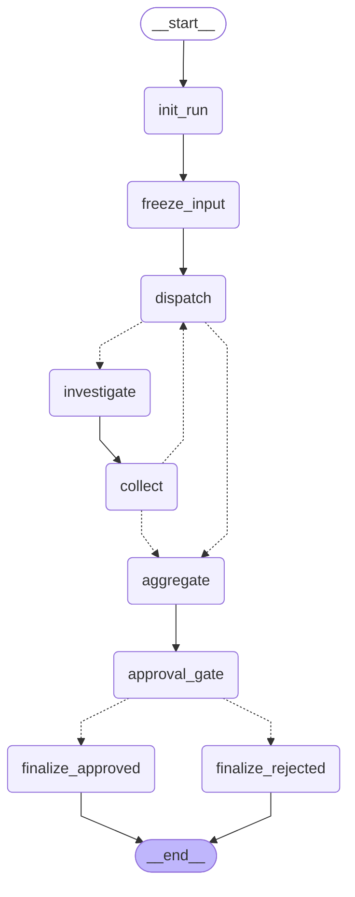
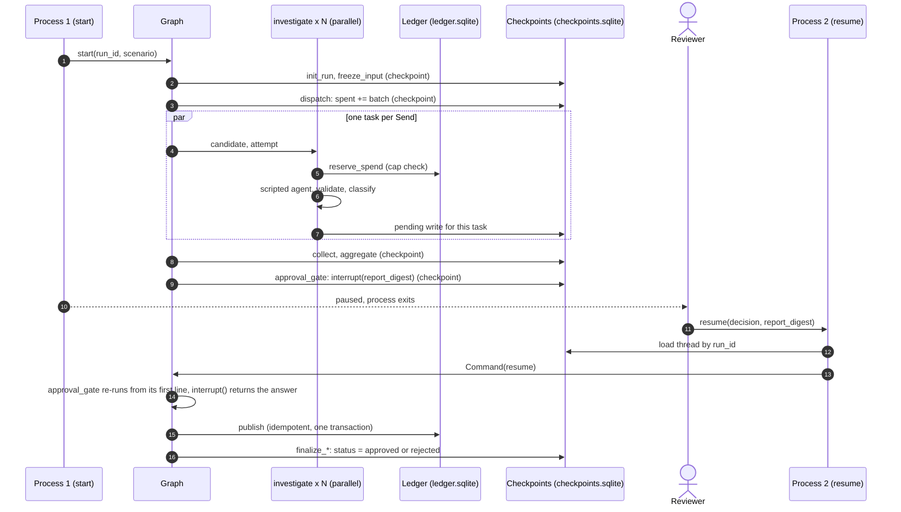

# S0 spike architecture

> **Status: throwaway spike, nothing here is the Repo Orchestrator.** It validates the orchestration runtime of [ADR-0005](../../../docs/adr/0005-langgraph-for-investigation-workflows-only.md) (Proposed) on synthetic data. No component of the production architecture ([architecture](../../../docs/architecture.md)) is implemented by it.

## Layers

| Layer | Module | Knows LangGraph? |
|---|---|---|
| Deterministic functions: output validation, quote verification, fact check, outcome classification, report normalization | `agent.py`, `models.py` | No (plain Python, unit-tested alone) |
| Scripted Investigator stand-in and synthetic repositories | `agent.py`, `scenarios.py` | No |
| Side-effect ledger (SQLite, outside the graph state) | `ledger.py` | No |
| Graph: nodes, reducers, routing, interrupt | `graph.py` | Yes |
| Facade: the only normal entry point (`start`, `recover`, `resume`, `status`) | `runner.py`, `cli.py` | Yes |

Removing LangGraph leaves the first three layers intact, as ADR-0005 §3 requires of a node-to-core relationship.

## Graph

Generated from the compiled graph (`python -m s0_spike graph`); `tests/test_docs.py` fails if this block drifts from the implementation. Dotted edges are conditional (routing functions); `dispatch -.-> investigate` is the `Send` fan-out.

| Node | Role | Writes |
|---|---|---|
| `init_run` | Validates the run request; refuses a thread that already holds a run (`RunAlreadyInitialized`); creates run metadata (nonce, start time) | `status`, `meta`, counters |
| `freeze_input` | Loads the scenario's candidates, sorts them, applies `max_candidates` (excess recorded as `insufficient_evidence/candidate_cap`, never dropped), computes `input_digest` | `candidates`, `candidate_ids`, `input_digest` |
| `dispatch` | Verifies the digest, computes pending work (first attempts, retriable failures under the attempt cap), applies the investigation and step caps, records denials, increments `spent` **before** any worker runs | `batch`, `spent`, `rounds`, `denials` |
| `investigate` | One task per `Send`. Reserves the spend in the ledger (second, authoritative cap check), runs the scripted agent, validates, classifies, **catches every exception** | `results[candidate#attempt]` |
| `collect` | Verifies the digest and that every dispatched item produced a result (else synthesizes `failed/no_result` and records an integrity error) | `integrity_errors` |
| `aggregate` | Latest attempt per candidate, canonical order, counts, report digest; `status = awaiting_approval` | `report`, `status` |
| `approval_gate` | `interrupt()`; validates the answer; an invalid answer pauses again | `decision` |
| `finalize_approved` / `finalize_rejected` | The irreversible effect (idempotent publication record), terminal status | `status`, `outcome` |

Routing: `dispatch` → `investigate` (one `Send` per work item) or `aggregate` (empty batch). `collect` → `dispatch` while work is pending, else `aggregate`. Termination: every `dispatch` either spends at least one investigation or records a denial for every pending item, and attempts are capped.

## Outcomes

| Outcome | Assigned when (all checks run in code) |
|---|---|
| `verified` | Output well-formed; every quote exists verbatim in the snapshot at the **pinned SHA**; every site of the candidate is covered; a **code-run fact check** (regex values at each site) confirms the claim |
| `supported` | Same, but the candidate has no mechanical check (qualitative claim) |
| `insufficient_evidence` | Missing evidence, unverifiable quote, claim contradicted by the check, investigation budget exhausted, candidate/investigation/step cap |
| `failed` | Agent exception or malformed output (retriable), or no result at all |

These are prototype outcomes, not production confidence or policy verdicts. The agent's output carries `claim` and `evidence` only; a self-declared `outcome` is ignored and kept for audit as `agent_asserted_outcome`.

## State and reducers

`RunInput` is the graph's **input schema**: `run_id`, `scenario`. Budgets, counters, decisions and outcomes are not settable through it (extra keys are dropped; verified by `test_start_input_exposes_only_run_request`).

| Field | Reducer | Why |
|---|---|---|
| `run_id`, `scenario` | `keep_first` | Identity is write-once; a later start input cannot rewrite it |
| `results` | `merge_results`: union by `candidate#attempt`; same key + same content = idempotent replay; same key + different content raises `ReducerConflict` | Parallel workers write concurrently; a re-executed task must not duplicate or contradict |
| `denials` | `merge_denials`: first reason stands | A denial is a fact about the first decision |
| `steps` | `operator.add` | Every node execution, workers included, counts toward `max_steps` |
| `integrity_errors` | `operator.add` | Append-only |
| everything else | last value | Single writer by construction |

## Limits

| Limit (`limits.py`) | Default | Enforced at |
|---|---|---|
| `max_candidates` | 10 | `freeze_input` |
| `max_attempts` | 2 | `dispatch` (pending work) |
| `max_investigations` | 15 | `dispatch` (state mirror) **and** `investigate` (ledger, authoritative) |
| `max_steps` | 60 | `dispatch` (reserves `STEP_RESERVE` = 4 steps for the tail) and `collect` routing |
| `max_units_per_investigation` | 5 | `Budget.spend` inside the agent runner |
| `recursion_limit` | 100 | LangGraph backstop only; raising `GraphRecursionError` is not a designed outcome |

Limits are code, passed to `build_graph`; they are copied into the report for transparency but never read back from state. Two checks exist because parallel workers of one superstep cannot see each other's spend in the state: the router counts the batch, the worker reserves against the ledger.

## Checkpoint strategy

- **Checkpointer:** `langgraph-checkpoint-sqlite` `SqliteSaver` on `<state-dir>/checkpoints.sqlite`. `thread_id` = `run_id`.
- **Durability:** every invocation passes `durability="sync"` so a checkpoint is committed before the next step starts. The framework default (`"async"`) was **not** measured here; the facade does not depend on it.
- **Granularity:** a checkpoint per superstep, and — what makes fan-out recoverable — pending writes per completed parallel task. After a hard kill, finished siblings are not re-run (`test_hard_kill_mid_fanout_then_recover_in_new_process`).
- **Second store:** `ledger.sqlite` (budget spend, execution log, one-shot markers, publication). It is deliberately **outside** the graph state so that it is authoritative for what already happened, whatever the checkpoint says. It is a separate file here; ADR-0008 allows the same file or a sibling.
- **Not stored in state:** snapshot contents (scenario code plays the role of pinned snapshots; M3 would store them content-addressed in the run store).

## Interrupt and resume

`approval_gate` calls `interrupt(payload)` with the report digest. The process may exit. A new process calls `Orchestrator.resume` → `Command(resume={decision, reviewer, report_digest, note})`.

- **LangGraph restarts the interrupted node from its first line** (observed, `test_interrupted_node_restarts_from_its_first_line`). `approval_gate` therefore has no side effect before `interrupt()`, and the irreversible effect lives in the next node.
- An approval is bound to the digest of the report the reviewer saw; a stale digest, an unknown decision or an empty reviewer pauses again instead of approving.
- `finalize_*` can also be re-executed (crash between effect and checkpoint). The effect is one SQLite transaction with its own primary key (`INSERT OR IGNORE` on `run_id`): the node ran twice, the effect once (`test_irreversible_effect_runs_once_when_finalize_is_killed_and_replayed`). A real external effect (a GitHub write; none exists before ADR-0007 level 2) needs an idempotency key honored by the target, or read-before-write.

## Failure boundaries

| Boundary | Mechanism |
|---|---|
| One investigation | `investigate` catches every `Exception`; the result is a typed `failed`/`insufficient_evidence` record. Without this, **one raising parallel task aborts the whole superstep and may lose finished siblings' results** (observed, racy: 30 of 300 trials lost at least one; `test_raising_parallel_task_aborts_the_superstep`) |
| Process death (`os._exit`, SIGKILL, OOM) | Not catchable. Recovery is `recover`: the thread resumes from the last checkpoint, finished siblings keep their results, the killed task re-runs the **same attempt** (ledger `duplicate`, no new spend) |
| Malformed or fabricated output | `validate_output` / `classify`; never promoted |
| Tampered frozen input | `input_digest` re-checked in `dispatch`, `collect`, `aggregate` |
| Missing result | `collect` / `aggregate` synthesize `failed/no_result` and record an integrity error; a candidate is never silently absent |

## Operator-level APIs vs normal input

| API | Class | Effect observed | Reachable from facade / CLI |
|---|---|---|---|
| `graph.invoke({run_id, scenario})` on a **new** thread | Normal input | Starts a run | Yes (`start`) |
| `graph.invoke(Command(resume=...))` at the gate | Normal input | Answers the interrupt | Yes (`resume`) |
| `graph.invoke(None)` | Normal, no payload | Continues pending tasks from the checkpoint | Yes (`recover`) |
| `graph.invoke({...})` on an **existing** thread | **Hazard** | `init_run` raises, but a pending `init_run` task remains: a paused thread is **wedged** (`phase = wedged`), its interrupt superseded | No: refused by the facade before the graph is touched |
| `graph.invoke(Command(update=...))` | **Operator** | Overwrites any state field, counters included (observed) | No |
| `graph.update_state(...)` | **Operator** | Same; frozen candidates are caught by the digest, counters are caught only by the ledger | No |
| `graph.get_state_history` + invoke on an old checkpoint (fork) | **Operator** | Repairs a wedged thread (observed) | No |

The facade is the only supported entry point; it contains no call to any operator API. Direct access to `checkpoints.sqlite` is operator access by definition.

## Execution sequence

